# 1 Introduction

## 1.1 What the tool does

The AFSAM Lug Tool (`excel/AFSAM_Lug_Tool.xlsx`) calculates the static strength of metallic lugs, their bushings, pins and tangs. It follows Section 9 of the *Stress Analysis Manual* of the Air Force Flight Dynamics Laboratory (1986). That method was developed by Melcon and Hoblit and is also found in Bruhn, chapter D1.

| Sheet | Configuration | AFSAM |
|---|---|---|
| **Input / Results / Calc** | Double shear joint (clevis): two outer lugs and one inner lug on one pin, axial load | 9.3, 9.4 |
| SingleShear | One lug against one lug; the pin and lugs bend | 9.5 |
| Transverse_Oblique | Lug loaded across its axis, or at an angle | 9.7, 9.10 |
| MultiShear | More than three lugs on one pin | 9.13 |
| Design | Sizing a new symmetric double shear joint from the load | 9.14 |

**The main improvement over the previous workbook: the chart coefficients are now read automatically.** These are $K$ (Fig 9-2, 9-3), $K_n$ (Fig 9-4) and $K_{tru}$, $K_{try}$ (Fig 9-8). They were digitized from the AFSAM figures and are interpolated in every direction. A hand-read value can still be entered in an override cell.

## 1.2 What the tool does not do

* fatigue (AFSAM 9.17);
* press-fit bushing stresses (9.16);
* composite lugs.

Lugs with less than 5 % elongation (9.15) are handled through a knockdown factor $B/B_{0.05}$. You read $B$ and $B_{0.05}$ from Fig 9-17 yourself and enter the ratio.

Units are N, mm and MPa.

# 2 The workbook

## 2.1 Sheets

| Sheet | Purpose | You type here? |
|---|---|---|
| README | Which sheet for which case, chart reading, load level | no |
| **Input** | Double-shear joint: outer and inner lug side by side, pin, tangs, load; input checks; sketches | **yes** |
| **Results** | Every failure mode of the double-shear joint with RF and status; joint allowable; chart readings used; summary of the other sheets | no |
| Calc | Every intermediate value of the double-shear joint, including the chart interpolation | no |
| SingleShear, Transverse_Oblique, MultiShear, Design | Each is self-contained: inputs (blue), calculation, results | yes |
| Charts | The digitized chart tables | no |
| Examples | The two AFSAM worked examples with published values | no |

## 2.2 Sheet Input

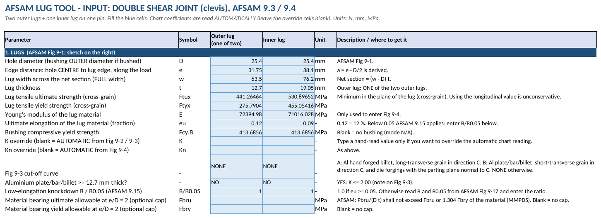{width=100%}

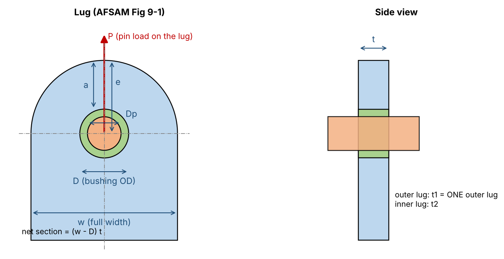{width=90%}

**Geometry.**

* $e$ is measured from the **hole centre** to the lug edge, along the load. The tool derives $a = e - D/2$ from it.
* $w$ is the **full** lug width. Note the difference to HSB, where $w$ is a half width.
* For the outer lugs, $t$ is **one** of the two outer lugs.

**Materials.** Use cross-grain properties ($F_{tux}$, $F_{tyx}$), i.e. the minimum in the plane of the lug. $E$ and the elongation $e_u$ are needed only to enter Fig 9-4.

**Chart overrides.** Leave $K$ and $K_n$ blank: they are then read automatically.

**Fig 9-3 cut-off curves and the 2.00 cap.** These apply only to aluminium product forms. Select them as described in the input text.

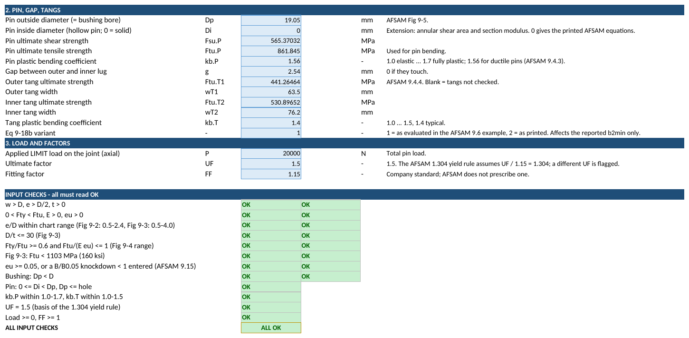{width=100%}

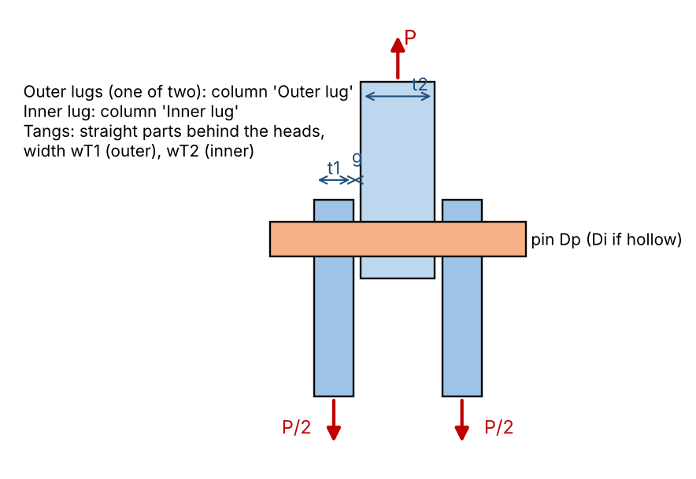{width=78%}

**Load level.** Enter the **limit** load. Every AFSAM allowable is an ultimate allowable, so

$$RF = \frac{P_{allowable}}{P\cdot UF\cdot FF}.$$

Yield is covered by the 1.304 rule (§4.3), which assumes $UF = 1.5$. The input checks flag any other $UF$.

## 2.3 Sheet Results

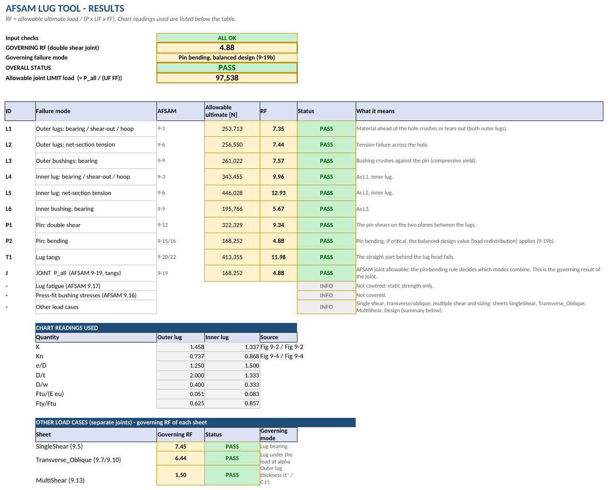{width=100%}

The table lists every failure mode of the double-shear joint:

* lug bearing (L1, L4);
* net section (L2, L5);
* bushings (L3, L6);
* pin shear (P1);
* pin bending (P2);
* tangs (T1);
* the **joint allowable** $P_{all}$ (row J). This is the governing result.

The joint allowable can be lower than every single mode. When the pin is critical in bending, AFSAM combines the lug and pin strengths in the *balanced design* equation (§4.5).

Below the table are two more blocks:

* **chart readings used:** the value of each coefficient and whether it came from the chart or from an override;
* **summary of the other sheets.**

## 2.4 Sheet Calc

The Calc sheet shows the chart look-up step by step, for each lug:

* curve indices;
* interpolation fractions;
* the values on the neighbouring curves;
* the result.

Below that it shows the AFSAM 9.4 joint calculation.

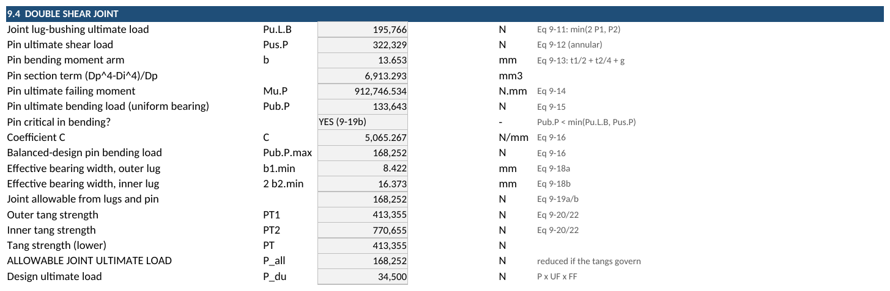{width=100%}

# 3 Worked example (AFSAM 9.6)

The default input is the AFSAM 9.6 example, converted to SI:

* 2024-T351 outer lugs, $D = 25.4$, $e = 31.75$, $w = 63.5$, $t = 12.7$ mm;
* a 7075-T651 inner lug, $t = 19.05$ mm;
* Al-bronze bushings;
* a 19.05 mm 4130 pin, gap $g = 2.54$ mm.

| Step | Outer lug | Inner lug |
|---|---|---|
| $e/D$, $D/t$ | 1.25, 2.0 → Fig 9-2 | 1.50, 1.33 → Fig 9-2 |
| $K$ automatic (AFSAM read) | 1.458 (1.46) | 1.337 (1.33) |
| $F_{tu}/(E e_u)$, $F_{ty}/F_{tu}$, $D/w$ | 0.051, 0.625, 0.40 | 0.083, 0.857, 0.33 |
| $K_n$ automatic (AFSAM read) | 0.737 (0.74) | 0.868 (0.87) |
| $P_{bru}$ (Eq 9-3) | 126 857 N | 343 455 N |
| $P_{u,B}$ (Eq 9-9) | 130 511 N | 195 766 N |
| $P_{u,L,B}$ | 126 857 N | 195 766 N |

**Joint calculation:**

* $P_{u,L,B} = \min(2 \times 126\,857,\ 195\,766) = 195\,766$ N
* $P_{us,P} = 322\,329$ N
* $P_{ub,P} = 133\,643$ N. This is lower than both values above, so the pin is critical in bending (9-19b).
* Balanced design: $P_{ub,P,max} = 168\,252$ N.

**Result:** $P_{all} = 168\,252$ N, against the published 168 588 N (−0.2 %). With $P = 20\,000$ N, $UF = 1.5$ and $FF = 1.15$: $RF = 168\,252 / 34\,500 = 4.88$.

# 4 Theory

## 4.1 Lug bearing: Fig 9-2 and Fig 9-3 (AFSAM 9.3.1)

A lug loaded through a pin fails ahead of the hole by bearing, shear-out or hoop tension, usually by a mix of the three. AFSAM lumps all three into one empirical **allowable load coefficient** $K$.

**Thick lugs, $D/t \le 5$ (Fig 9-2).** $K$ is a function of $e/D$:

$$F_{bru,L} = K\frac{a}{D}F_{tux}\ \ (e/D < 1.5), \qquad F_{bru,L} = K F_{tux}\ \ (e/D \ge 1.5)$$

$F_{bry,L}$ is the same with $F_{tyx}$.

* Below $e/D = 1.5$ shear-out governs, and the load is proportional to the distance $a$ ahead of the hole.
* Above $e/D = 1.5$ bearing governs.

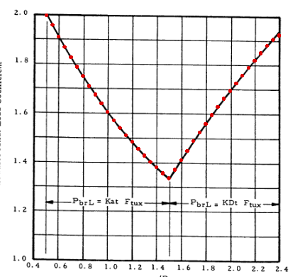{width=55%}

**Thin lugs, $D/t > 5$ (Fig 9-3).** Thin lugs are weaker, so a family of curves is used, one for each $D/t$. The tool uses this figure as a **bearing efficiency factor**, as its title says:

$$F_{bru,L} = K F_{tux}$$

**How Fig 9-3 is entered (an interpretation).** The figure's axis label reads $a/D$. However, its sketch dimensions $a$ from the **hole centre** to the lug edge, which is AFSAM's $e$. The tool therefore enters Fig 9-3 with $e/D$, for these reasons:

* With this reading, the $D/t \le 2$ curve of Fig 9-3 agrees with Fig 9-2 within about 10 % over the whole range. For thick lugs both figures must describe the same strength.
* The curves start at $e/D = 0.5$. That is exactly where the hole breaks out of the edge.

The previous workbook entered Fig 9-3 with $a/D$ (hole edge to lug edge) and multiplied by $a/D$ again. That under-predicts the strength by up to 60 %: conservative, but strongly so. The figure below compares the three readings.

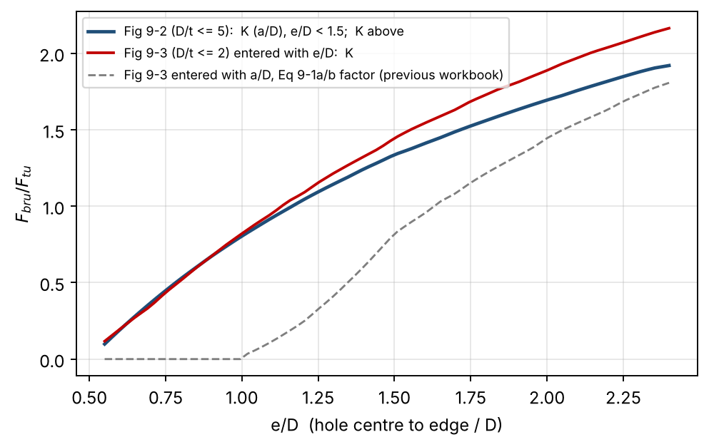{width=70%}

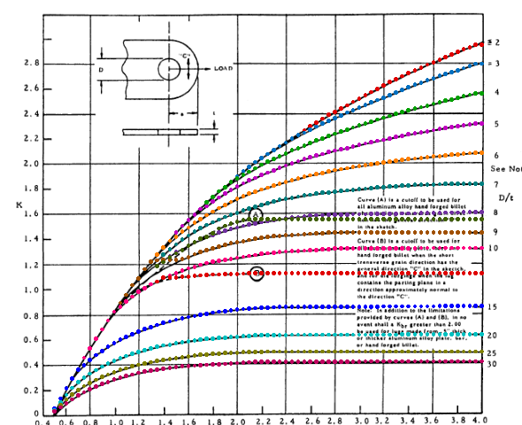{width=85%}

**Fig 9-3 cut-offs and cap.**

* Cut-off curve A applies to aluminium hand-forged billet with the long-transverse grain in direction "C".
* Cut-off curve B applies to aluminium plate, bar and hand-forged billet with the short-transverse grain in "C", and to die forgings with the parting plane normal to "C".
* For aluminium plate, bar or billet of 0.5 in (12.7 mm) or thicker, $K \le 2.00$.

The tool applies these when you select them on Input.

**Allowable bearing load** (Eq 9-3):

$$P_{bru,L} = F_{bru,L}\,D\,t\ \ (F_{tux} \le 1.304F_{tyx}), \qquad P_{bru,L} = 1.304\,F_{bry,L}\,D\,t\ \ (\text{otherwise})$$

AFSAM adds that $P_{bru,L}/(Dt)$ shall not exceed $F_{bru}$ or $1.304F_{bry}$ of the material at $e/D = 2$ (MMPDS). Enter these values in the optional cap cells.

## 4.2 Net section: Fig 9-4 (AFSAM 9.3.2)

The net section through the hole fails in tension at a stress lower than $F_{tu}$, because of the stress concentration at the hole. A ductile material relieves this concentration by yielding before it fails; a brittle one does not. The net-tension coefficient $K_n$ therefore depends on three parameters:

* the geometry, $D/w$;
* the strain capacity, $F_{tu}/(E e_u)$: 0 for a perfectly ductile material, 1 for a brittle one;
* the shape of the stress-strain curve, $F_{ty}/F_{tu}$: panels for 1.0, 0.8 and 0.6.

$$F_{nu,L} = K_n F_{tu}, \qquad F_{ny,L} = K_n F_{ty}$$

The net-section load $P_{nu,L}$ uses the area $(w - D)t$, with the same 1.304 rule as for bearing.

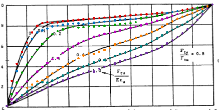{width=70%}

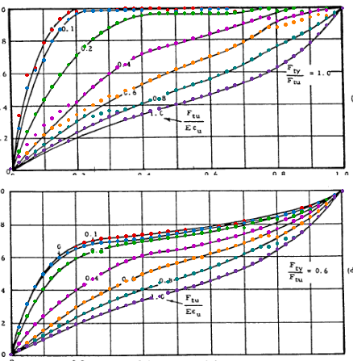{width=70%}

The tool interpolates linearly in all three parameters. Values of $F_{ty}/F_{tu}$ below 0.6 are clamped to the 0.6 panel, and the input checks flag them.

## 4.3 Bushing and the 1.304 rule (AFSAM 9.3.4)

The bushing fails by compressive yield under the pin:

$$P_{u,B} = 1.304\,F_{cy,B}\,D_p\,t$$

The lug–bushing allowable is $P_{u,L,B} = \min(P_{u,L}, P_{u,B})$, where $P_{u,L} = \min(P_{bru,L}, P_{nu,L})$.

**The factor 1.304** equals $1.5/1.15$, the ratio of the ultimate factor to the yield factor. Multiplying a yield allowable by 1.304 places it on the ultimate scale. The ultimate allowable can then be compared with the ultimate load, and that comparison also guarantees no yield at $1.15 \times$ limit. This is why the tool checks that $UF = 1.5$.

## 4.4 Pin shear and bending (AFSAM 9.4.2, 9.4.3)

**Pin shear.** The pin is cut on two planes:

$$P_{us,P} = 1.571\,(D_p^2 - D_i^2)\,F_{su,P}$$

**Pin bending.** The bearing load is assumed uniform across each lug thickness. The moment arm is

$$b = \frac{t_1}{2} + \frac{t_2}{4} + g$$

and the pin bending capacity is

$$M_{u,P} = 0.0982\,k_{b,P}\,\frac{D_p^4 - D_i^4}{D_p}\,F_{tu,P}, \qquad P_{ub,P} = \frac{2M_{u,P}}{b}$$

* $k_{b,P}$ is the plastic bending coefficient: 1.0 for elastic, up to 1.7 for fully plastic, 1.56 for ductile pins.
* $D_i$ is the bore of a hollow pin. This is an engineering extension; $D_i = 0$ gives the printed AFSAM equations.

## 4.5 Joint allowable and balanced design (AFSAM 9.4.3)

* **If $P_{ub,P} \ge \min(P_{u,L,B}, P_{us,P})$**, the pin is not critical in bending:
$$P_{all} = \min(P_{u,L,B}, P_{us,P}) \quad (9\text{-}19a)$$
* **Otherwise the pin bends.** The bearing load then concentrates near the shear faces, which shortens the moment arm. AFSAM finds the largest load at which the pin moment and the local lug bearing are in balance:
$$C = \frac{P_1P_2}{P_1t_2 + P_2t_1}, \qquad P_{ub,P,max} = 2C\left(\sqrt{\frac{P_{ub,P}}{C}\,b + g^2} - g\right), \qquad P_{all} = \min(P_{us,P}, P_{ub,P,max})\quad(9\text{-}19b)$$

In these equations, $P_1$ and $P_2$ are the lug–bushing allowables of the outer and inner lug.

The effective bearing widths $b_{1,min} = P_{ub,P,max}\,t_1/(2P_1)$ and $2b_{2,min}$ are reported. Eq 9-18b has two variants, the printed form and the form used in the AFSAM example; they affect only the reported width $b_2$.

## 4.6 Lug tangs (AFSAM 9.4.4)

The straight part behind the lug head (the tang) carries the load in tension:

$$P_{T1} = 2F_{tu,T1}w_{T1}t_1, \qquad P_{T2} = F_{tu,T2}w_{T2}t_2$$

If the pin bends (9-19b), the outer lug load is eccentric, and the outer tang is reduced by the factor $1 + (3/k_{b,T})(1 - b_{1,min}/t_1)$. When the tangs are weaker than the joint, they govern $P_{all}$.

## 4.7 Single shear joint (AFSAM 9.5)

In a single shear joint the lug carries an axial load $P$ plus a socket moment $M$. The stresses are as follows.

**Lug, net section and bushing** (Eq 9-23 to 9-25):

$$f_{br} = \frac{P}{Dt} + \frac{6M}{k_{b,L}Dt^2}, \qquad f_{net} = \frac{P}{(w - D)t} + \frac{6M}{k_{b,L}(w - D)t^2}, \qquad f_{bu} = \frac{P}{D_pt} + \frac{6M}{k_{b,L}D_pt^2}$$

**Pin shear and pin bending** (Eq 9-26, 9-27) depend on $m = M/(Pt)$:

* **pin shear:** $1.273P/D_p^2$ if $m \le 2/3$, otherwise multiplied by $(\sqrt{u^2+1} - 1)/(u + 1 - \sqrt{u^2+1})$, with $u = 2m$;
* **pin bending:** $10.19\,M/(k_{b,P}D_p^3)\,(Pt/2M - 1)$ if $m \le 3/8$, otherwise $10.19\,M/(k_{b,P}D_p^3)\,(\sqrt{u^2+1} - 1)/u$.

The RF of each mode is its allowable stress over the stress at ultimate load.

## 4.8 Transverse and oblique load (AFSAM 9.7, 9.10)

**Transverse load.** The effective edge distance weights the loaded side three times:

$$h_{av} = \frac{6}{3/h_1 + 1/h_2 + 1/h_3 + 1/h_4}$$

$K_{tru}$ and $K_{try}$ are read automatically from Fig 9-8 at $h_{av}/D$:

$$F_{bru} = K_{tru}F_{tux}, \qquad F_{bry} = K_{try}F_{tyx}, \qquad P_{tru,L}\ \text{from the 1.304 rule as in 4.1}$$

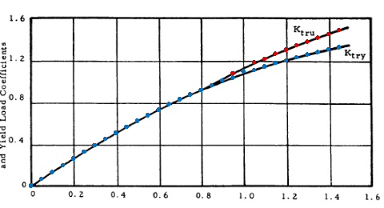{width=60%}

**Oblique load at angle $\alpha$.** The axial and transverse allowables interact through an exponent of 1.6 (Eq 9-31). The tool solves it in closed form:

$$\left(\frac{P\cos\alpha}{P_{u,L}}\right)^{1.6} + \left(\frac{P\sin\alpha}{P_{tru,L}}\right)^{1.6} = 1 \ \Rightarrow\ P_\alpha = \left[\left(\frac{\cos\alpha}{P_{u,L}}\right)^{1.6} + \left(\frac{\sin\alpha}{P_{tru,L}}\right)^{1.6}\right]^{-1/1.6}$$

The bushing is checked as in the axial case.

## 4.9 Multiple shear connection (AFSAM 9.13)

For $n$ lugs on one pin, each inner lug carries $P_1 = P/(n-1)$. AFSAM Table 9-2 then gives three values:

* the outer lug coefficient $C$, which sets the requirement $t'' \ge C t'$;
* the maximum pin shear load;
* the bending arm.

The pin stresses are then computed with the 9.5 forms. AFSAM itself stops at the loads, so this last step is an engineering extension.

## 4.10 Sizing (AFSAM 9.14)

The Design sheet follows AFSAM 9.14.1:

* allowable bearing stresses with $K$ from Fig 9-14;
* the mode parameter $R$ (Eq 9-32);
* the pin diameter for shear (9-33) and for bending (9-35);
* the bushing diameter $D = D_p + 2t_B$;
* the concentric-lug proportions from the optimum $e/D$ of Fig 9-15;
* in a second pass with the lug thicknesses, the bending diameter (9-34), solved by Newton iteration;
* the optimum $D_{p,opt} = \tfrac13 D_p(9\text{-}35) + \tfrac23 D_p(9\text{-}34)$ (9-36).

Figs 9-14 and 9-15 are read by hand on this sheet. The sizing is approximate: always verify the final design on Input/Results.

# 5 Chart digitization

The four charts used by the analysis (Fig 9-2, 9-3 with A/B, 9-4, 9-8) were digitized from the figure scans in four steps:

1. The axes were calibrated on the charts' own grid lines, piecewise between neighbouring grid lines, which absorbs scan distortion.
2. Each curve was followed pixel by pixel from visually read guide points, with grid lines and text masked out.
3. Physical rules were enforced: curves do not cross, $K$ does not decrease with $e/D$, and Fig 9-3 is a straight line from the origin below $e/D = 0.65$, where the curves cannot be separated.
4. Every curve was drawn back over the scan and checked visually. These are the overlay figures in this manual and in `docs/figures`.

**Accuracy** is about ±0.01–0.02 in the coefficient. The digitized charts reproduce the four chart readings printed in AFSAM 9.6 within 0.01:

| Reading | AFSAM | Digitized |
|---|---|---|
| $K$ outer (Fig 9-2, $e/D = 1.25$) | 1.46 | 1.458 |
| $K$ inner (Fig 9-2, $e/D = 1.50$) | 1.33 | 1.337 |
| $K_n$ outer (Fig 9-4) | 0.74 | 0.737 |
| $K_n$ inner (Fig 9-4) | 0.87 | 0.868 |

The automatic $K_n$ depends on $e_u$. The example does not state $e_u$, so 0.12 (2024-T351) and 0.09 (7075-T651) were assumed. In the steep part of a curve, an uncertain $e_u$ or $D/w$ changes $K_n$ more than the reading accuracy does.

**Scripts and data.** The digitization scripts are in `tools/digitize/`, and the data in `handcalc/afsam_charts.py` and on sheet *Charts*.

# 6 Verification

| Example | Values | Python | Workbook |
|---|---|---|---|
| AFSAM 9.6 (with AFSAM's chart readings) | 16 published values | all within 0.5 % | all within 0.5 % |
| AFSAM 9.6 (automatic charts) | joint allowable | −0.2 % | −0.2 % |
| AFSAM 9.14.1.3 sizing | 10 published values | all within 1 % | all within 1 % |

In addition, the workbook (recalculated by LibreOffice) and the Python implementation `handcalc/afsam_lug.py` agree to $10^{-9}$ for:

* two joint cases. The second covers Fig 9-3, both cut-off curves, the 2.00 cap, the $B/B_{0.05}$ knockdown, a material cap, a hollow pin and a lug without bushing.
* the single shear, transverse/oblique and multiple shear sheets.

# 7 Validity limits (input checks)

| Check | Reason |
|---|---|
| $e/D$ in 0.5–2.4 (Fig 9-2) or 0.5–4.0 (Fig 9-3); $D/t \le 30$ | chart range |
| $F_{ty}/F_{tu} \ge 0.6$, $F_{tu}/(E e_u) \le 1$ | range of Fig 9-4 |
| Fig 9-3: $F_{tu} < 1103$ MPa (160 ksi) | title of Fig 9-3 |
| $e_u \ge 0.05$, or a knockdown $B/B_{0.05} < 1$ entered | AFSAM 9.15 |
| $UF = 1.5$ | basis of the 1.304 rule |
| $D_p < D$ with bushing, $0 \le D_i < D_p$, $k_{b,P}$ 1.0–1.7, $k_{b,T}$ 1.0–1.5 | physical / AFSAM limits |

# 8 Changes from the previous workbook (v5.0)

* **Automatic chart reading** of K, Kn, Ktru and Ktry, with overrides. Previously all four were typed in by hand.
* **Fig 9-3** is entered with $e/D$ and used as $K F_{tu}$ (§4.1). The cut-off curves A/B and the 2.00 cap are applied automatically when selected.
* **Results:** one sheet lists every failure mode with its RF and status, plus the joint allowable, the chart readings used, and a summary of all load-case sheets.
* **Load and factors:** default $UF = 1.5$, $FF = 1.15$ (previously 1.0 / 1.0). $UF \ne 1.5$ is flagged, because of the 1.304 rule.
* **Material bearing caps** and the **9.15 knockdown** are applied in every lug calculation, not on a separate sheet.
* **Verification** is done by the automated tests on the real calculation, not by a copy of the formulas.
* **Stale notes and version numbers removed.**

# 9 Editing the workbook

* Formulas use named cells. The suffix `_o` is the outer lug, `_i` the inner lug, and `_ss`, `_tr` belong to the SingleShear and Transverse sheets.
* The chart look-ups on Calc are ordinary `INDEX` formulas on sheet Charts.
* After changing a formula, run `python -m pytest`. Both AFSAM examples are part of the tests.
* The layout is generated by `tools/build_afsam_lug.py`, and the chart data by `tools/digitize/make_tables.py`. Rebuilding overwrites manual edits.

# 10 References

1. *Stress Analysis Manual*, Air Force Flight Dynamics Laboratory, Wright-Patterson AFB, October 1986, Section 9 (Lug Analysis).
2. M. A. Melcon, F. M. Hoblit, *Developments in the analysis of lugs and shear pins*, Product Engineering, June 1953.
3. E. F. Bruhn, *Analysis and Design of Flight Vehicle Structures*, chapter D1.
4. MMPDS / MIL-HDBK-5: material and bearing allowables.
