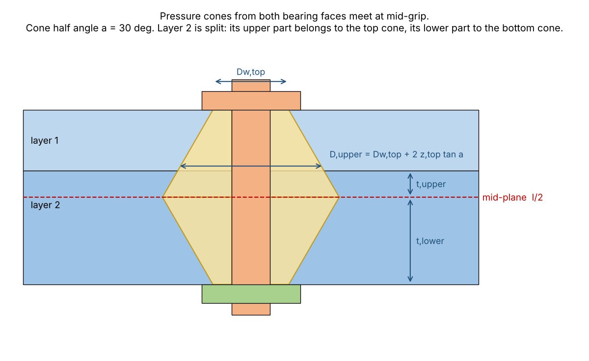
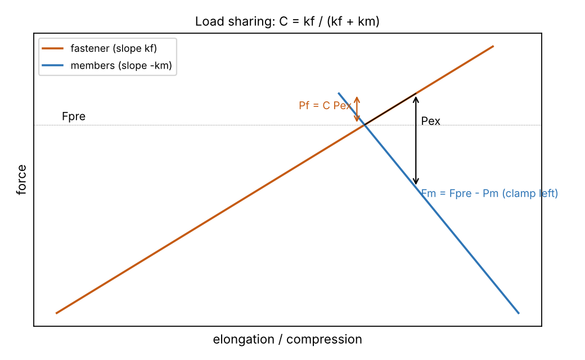

# 1 Purpose and scope

The Bolted Joint Tool (`excel/Bolted_Joint_Tool.xlsx`) checks one pre-loaded fastener under an axial and a shear load. It returns a reserve factor (RF) for every failure mode, the governing mode, and the tightening-torque window that satisfies all modes at the same time.

* **Configurations:** BOLT (head + nut), SCREW (head, threaded into a tapped housing), STUD (stud end in a tapped housing, nut on the other end).
* **Loads:** limit-level axial load $P_{ex}$ (tension positive) and shear load $P_{shear}$ at the fastener, e.g. from a FEM fastener element.
* **Units:** N, mm, MPa; torque in N·m.
* **Not covered:** load distribution in a bolt group, prying, eccentric loading of the joint, thermal loads, and bending of the fastener. Calculate those effects first and enter the resulting fastener loads.

# 2 Quick start

1. Open sheet **Input** and fill the blue cells from top to bottom. The *Description* column explains each input, and the *Used by* column lists the failure modes it affects.
2. Select the fastener type and the thread from the drop-down lists. Leave the diameter override cells blank to use the table values, or type the minimum diameters of your tolerance class.
3. Fill the **joint stack** table from the top bearing face downwards (washers and plates). Leave unused rows blank.
4. Check that **INPUT CHECKS** reads *ALL OK*.
5. Read sheet **Results**. Every failure mode is always listed, even when you only need some of them for your task.

| Status | Meaning |
|---|---|
| PASS / FAIL | RF ≥ 1 / RF < 1 |
| N/A | The mode does not exist for this configuration (e.g. nut thread of a SCREW). |
| NOT EVALUATED | The mode is real but an optional input is blank. Column *Required inputs* says which one. |
| INFO | Qualitative mode; guidance only. |

The overall status reports FAIL if any mode fails, and it states how many modes were not evaluated.

# 3 Inputs

{width=100%}

| Group | Inputs | Notes |
|---|---|---|
| Thread | type, thread, $d$, $d_p$, $d_r$ (stud end: $d_s$, $d_{p,s}$, $d_{r,s}$), shank diameter $d_{sh}$ | Table values are basic or minimum sizes. Minimum diameters are conservative. |
| Lengths | $L$, $L_T$, $L_{T,s}$, $L_{e,nut}$, $L_{e,h}$ | BOLT/SCREW: $L$ under the head. STUD: overall length. |
| Joint stack | up to 8 layers $(t_i, E_i)$, $D_{w,top}$, $D_{w,bot}$, $\alpha$ | For SCREW and STUD the last layer is the housing, measured down to the end of the engaged thread. |
| Materials | $E_f$, $F_{ty}$, $F_{tu}$, $F_{su}$, $F_{su,nut}$, $F_{su,h}$ | $F_{su}$ blank → $0.577\,F_{tu}$. $F_{su,h}$ is required for SCREW and STUD. |
| Loads, factors | $P_{ex}$, $P_{shear}$, $UF$, $FF$, $CF$ | Limit loads. Default $UF = 1.5$, $FF = 1.15$, $CF = 1.0$. |
| Tightening | $T$, $K$, $\mu$, $\Gamma$, $f_z$ | $\Gamma$ is the preload scatter (± fraction); $f_z$ is the embedment. |
| Optional | threads in shear plane, $D_h$, $p_{allow}$, $t_{min}$, $F_{bru}$, $P_a$, $P_{m,cyc}$, $S_e$ | Leave blank to skip the corresponding mode. |

# 4 Theory

## 4.1 Sections

The tensile stress area uses the mean of the pitch and minor diameters. The shank area uses the shank diameter:

$$d_t = \frac{d_p + d_r}{2}, \qquad A_t = \frac{\pi d_t^2}{4}, \qquad A_d = \frac{\pi d_{sh}^2}{4}$$

For ISO metric threads this is exactly the ISO 898-1 stress area. For UN threads the thread table stores the minor diameter that reproduces the ASME B1.1 stress area $\tfrac{\pi}{4}(d-0.9743P)^2$. For a STUD, the smaller area of the two ends is used in the strength checks.

## 4.2 Fastener stiffness

The fastener is a set of springs in series over the grip length $l = \sum t_i$.

BOLT and SCREW, with unthreaded length $l_d = \min(L - L_T,\ l)$ and threaded length $l_t = l - l_d$ in the grip:

$$\frac{1}{k_f} = \frac{l_t}{A_t E_f} + \frac{l_d}{A_d E_f}$$

STUD, with nut-end thread in the grip $l_t = L_T - (L - l)$ and shank $l_d = L - L_T - L_{T,s}$:

$$\frac{1}{k_f} = \frac{l_t}{A_{t} E_f} + \frac{L_{T,s}}{A_{t,s} E_f} + \frac{l_d}{A_d E_f}$$

## 4.3 Member stiffness

The clamped parts are loaded through two pressure cones with half angle $\alpha$ (30°). One cone starts at the top bearing face (diameter $D_{w,top}$), the other at the bottom face ($D_{w,bot}$), and they meet at mid-grip $l/2$. Every layer is split at the mid-plane. Its upper part, of thickness $t_u$, belongs to the top cone, and its lower part, $t_l$, to the bottom cone. The smaller diameter of each frustum follows from similar triangles:

$$D_u = D_{w,top} + 2 z_{top} \tan\alpha, \qquad D_l = D_{w,bot} + 2\,(l - z_{bot}) \tan\alpha$$

Here $z$ is measured from the top bearing face. A frustum of thickness $t$, smallest diameter $D$ and modulus $E$ has the compliance

$$\frac{1}{k} = \frac{1}{\pi E d \tan\alpha}\,\ln\!\left[\frac{(2t\tan\alpha + D - d)(D + d)}{(2t\tan\alpha + D + d)(D - d)}\right]$$

All frusta act in series: $1/k_m = \sum 1/k_i$.

{width=75%}

This is the similar-triangles method of the in-house method document, written for any number of layers. For the document's worked example (two washers, plate, housing) it gives the published $t_{middle}$ and $D^*$ values. When the mid-plane falls inside the top plate, the split simply happens in that plate, so the result stays valid for any stack.

## 4.4 Load sharing

{width=60%}

$$C = \frac{k_f}{k_f + k_m}, \qquad P_f = C\,P_{ex}, \qquad P_m = (1 - C)\,P_{ex}$$

$P_f$ is the part of the external load that adds to the fastener force. $P_m$ is the part that relieves the clamp force. A compressive $P_{ex}$ is set to zero, because the fastener does not carry compression.

## 4.5 Preload

$$F_{pre} = \frac{T}{K d}, \qquad F_z = f_z \frac{k_f k_m}{k_f + k_m}, \qquad F_{pre,max} = F_{pre}(1+\Gamma), \qquad F_{pre,min} = F_{pre}(1-\Gamma) - F_z$$

$F_{pre,max}$ is used for the strength checks and $F_{pre,min}$ for separation and slip. With $\Gamma = 0$ and $f_z = 0$ both equal the nominal preload, which is the original method.

Typical scatter values are $\Gamma \approx 0.25$–$0.35$ for torque control with a torque wrench and about $0.1$ for yield- or angle-controlled tightening.

## 4.6 Failure modes

The fastener loads are $P_{tot} = F_{pre,max} + P_f$ (limit) and $P_{tot,u} = F_{pre,max} + UF\,P_f$ (ultimate).

**FM01 Tensile yield (limit)** and **FM02 Tensile ultimate:**
$$RF_{y} = \frac{F_{ty}}{FF\cdot P_{tot}/A_t}, \qquad RF_{u} = \frac{F_{tu}}{FF\cdot P_{tot,u}/A_t}$$

**FM03 Nut-end thread stripping** (BOLT, STUD) and **FM04 Housing thread stripping** (SCREW, STUD). The thread shear areas are

$$A_{s,nut} = \pi d_p \tfrac{5}{8} L_{e,nut}, \qquad A_{s,h} = \pi d_p \tfrac{3}{4} L_{e,h}$$

and the reserve factors are

$$RF = \frac{F_{su}}{UF\cdot FF\cdot P_{tot}/A_{s,nut}}, \qquad RF = \frac{F_{su}}{UF\cdot CF\cdot P_{tot}/A_{s,h}}$$

The factor $UF$ (1.5) acts on the total limit load including preload, as in the method document. $F_{su}$ is the weaker of the two mating materials: fastener and nut, or fastener and housing.

**FM05 / FM06 Joint separation (limit / ultimate):**
$$RF = \frac{F_{pre,min}}{FF\cdot P_m}, \qquad RF = \frac{F_{pre,min}}{UF\cdot FF\cdot P_m}$$

**FM07 / FM08 Slip (limit / ultimate):**
$$RF = \frac{(F_{pre,min} - P_m)\,\mu}{P_{shear}}, \qquad RF = \frac{(F_{pre,min} - UF\,P_m)\,\mu}{UF\,P_{shear}}$$

**FM09 Fastener shear.** If the joint slips, the fastener carries the shear itself. The shear area $A$ is $A_d$, or $A_t$ when threads are in the shear plane:
$$RF = \frac{F_{su}}{UF\cdot FF\cdot P_{shear}/A}$$

**FM10 Combined tension and shear.** This is an elliptic interaction. Including preload in $R_t$ is conservative.
$$R_t = \frac{FF\, P_{tot,u}/A_t}{F_{tu}}, \quad R_s = \frac{1}{RF_{FM09}}, \quad RF = \frac{1}{\sqrt{R_t^2 + R_s^2}}$$

**FM11 Bearing pressure under the head or nut.** $A_b = \tfrac{\pi}{4}(D_w^2 - D_h^2)$. For a BOLT the smaller of the two faces is used.
$$RF = \frac{p_{allow}}{FF\cdot P_{tot}/A_b}$$

**FM12 Hole-wall bearing** of the thinnest plate in shear:
$$RF = \frac{F_{bru}}{UF\cdot FF\cdot P_{shear}/(d\, t_{min})}$$

**FM13 Fatigue** (Goodman, Shigley eq. 8-38). The stresses are $\sigma_i = F_{pre,max}/A_t$, $\sigma_a = C P_a/A_t$ and $\sigma_m = \sigma_i + C P_{m,cyc}/A_t$. The endurance limit $S_e$ must already include the thread effect (rolled threads: 129, 162 and 190 MPa for grades 8.8, 10.9 and 12.9).
$$n_f = \frac{S_e (F_{tu} - \sigma_i)}{F_{tu}\,\sigma_a + S_e(\sigma_m - \sigma_i)}, \qquad RF = \frac{n_f}{FF}$$

**FM14 Tightening-torque window.** See §4.7.

**FM15 Self-loosening** and **FM16 Galling** are qualitative.
* Self-loosening is driven by transverse slip, so under vibration keep FM07 and FM08 ≥ 1 or use a locking feature.
* Galling affects stainless or titanium threads. Lubricate them, or use coated or dissimilar materials.

## 4.7 Tightening-torque window

**Minimum torque.** The minimum preload must prevent separation and slip at ultimate load:

$$F_{req} = UF\,P_m + \frac{UF\,P_{shear}}{\mu}, \qquad T_{min} = \frac{K d\,(F_{req} + F_z)}{1-\Gamma}$$

**Maximum torque.** The maximum preload must keep FM01–FM04 at RF ≥ 1:

$$F_{cap} = \min\left(\frac{F_{ty}A_t}{FF} - P_f,\ \frac{F_{tu}A_t}{FF} - UF P_f,\ \frac{F_{su}A_{s,nut}}{UF\,FF} - P_f,\ \frac{F_{su}A_{s,h}}{UF\,CF} - P_f\right)$$

$$T_{max} = \frac{K d\, F_{cap}}{1+\Gamma}$$

**FM14:** $RF = \min(T/T_{min},\ T_{max}/T)$.

Note that the method document takes the *larger* of the thread and material limits. The tool takes the *smaller*, because every limit must be respected.

# 5 Verification

The workbook is checked automatically. `handcalc/bolted_joint.py` is an independent Python implementation of the same method. The test suite (`tests/`) recalculates the Excel file with LibreOffice and compares every RF, status and intermediate value with the Python implementation, to a relative tolerance of $10^{-9}$, for five cases: stud, bolt, screw, a thick top plate, and a compressive load.

The Python implementation is in turn checked against published numbers:

| Check | Reference | Result |
|---|---|---|
| Member stiffness of the worked example | method document Table 5: 620 902 N/mm | 621 073 N/mm (+0.03 %) |
| $t_{middle}$, $D^*$, $D_{w2}$, $D_{n1}$ | Table 3: 2.0 / 28.94 / 14.14 / 15.08 mm | identical |
| Fastener stiffness of the worked example | Table 5: 351 941 N/mm | within 1 % (rounded areas in the document) |
| Two equal plates | Shigley closed form | identical ($10^{-12}$) |
| Bolt sheet of the previous tool | $k_f$, $k_m$, $F_{pre}$, RF yield | identical ($10^{-8}$) |

# 6 Assumptions and limits

* Linear-elastic joint and concentric loading. The cone half angle is constant (30° by default).
* Thread stripping uses the simplified shear areas ($5/8$ and $3/4$ of $\pi d_p L_e$) of the method document. These assume full-profile engagement, so do not count chamfered or incomplete threads in $L_e$.
* The nut factor $K$ lumps thread and under-head friction together. If $\mu_G$ and $\mu_K$ are known, convert them with $K \approx 0.161 P/d + 0.577\mu_G d_p/d + 0.5\mu_K D_{km}/d$ (VDI 2230).
* Only the tightening torque is checked against preload. Torsional stress during tightening is not checked. With a high preload ($F_{pre}/A_t > 0.7 F_{ty}$), check the tightening condition separately.
* VDI 2230 is a licensed standard and is not reproduced here. The optional preload-scatter and embedment terms follow its concepts, and the remaining extensions (shear, interaction, fatigue) follow open references.

# 7 Editing the workbook

Nothing is locked or hidden. Formulas use named cells (*Formulas → Name Manager*), so an equation reads like the text above. For example, FM01 is `=Fty/(FF_fit*sig_lim)`.

* To add a thread, insert a row on sheet **Threads** above the CUSTOM row.
* After changing a formula, run `python -m pytest` in the repository to confirm that the examples still match.
* The workbook layout is generated by `tools/build_bolted_joint.py`. Use it only if you want to regenerate the file from scratch.

# 8 References

1. In-house method document "Fastener Strength Calculations", Issue 1: stiffness, similar-triangles cone method, thread-shear and torque equations.
2. R. G. Budynas, J. K. Nisbett, *Shigley's Mechanical Engineering Design*, chapter 8.
3. NASA-STD-5020, *Requirements for Threaded Fastening Systems in Spaceflight Hardware*: preload scatter, separation, interaction.
4. VDI 2230 Part 1, *Systematic calculation of highly stressed bolted joints*: concepts only.
5. G. H. Junker, *New criteria for self-loosening of fasteners under vibration*, SAE 690055.
