# 1 Introduction

## 1.1 What the tool does

The Bolted Joint Tool (`excel/Bolted_Joint_Tool.xlsx`) analyses **one pre-loaded fastener** that carries an axial load and a shear load. For that fastener it computes:

* the stiffness of the fastener and of the clamped parts, and how the external load is shared between them;
* the preload from the tightening torque, including optional preload scatter and embedment loss;
* a **reserve factor (RF)** for each of 14 calculated failure modes, plus 2 qualitative modes;
* the **governing failure mode** and an overall PASS/FAIL;
* the **tightening-torque window** $T_{min}$–$T_{max}$ inside which all modes are satisfied.

Three configurations are covered:

| Type | Description | Thread checks |
|---|---|---|
| BOLT | head + nut | nut-end thread |
| SCREW | head, threaded into a tapped housing, no nut | housing thread |
| STUD | one end screwed into a tapped housing, nut on the other end | nut-end and housing thread |

## 1.2 What the tool does not do

The tool works on the loads **at one fastener**. Before you use it, determine the following separately and enter the resulting fastener loads:

* load distribution within a bolt group;
* prying;
* eccentric (moment) loading of the joint;
* thermal loads;
* fastener bending.

Units are N, mm and MPa throughout. Torque is in N·m.

## 1.3 How this manual is organised

| Chapter | Content |
|---|---|
| 2 | The workbook sheet by sheet, with screenshots |
| 3 | A worked example from input to result |
| 4 | The theory, with the origin of every equation |
| 5 | What to do when a mode fails |
| 6 | Verification of the workbook |
| 7 | Assumptions and limits |
| 8 | How to edit the workbook safely |

# 2 The workbook

## 2.1 Sheets

| Sheet | Purpose | You type here? |
|---|---|---|
| README | Short instructions and colour code | no |
| **Input** | All inputs, each with description, unit and the failure modes it affects; input checks; joint sketch | **yes (blue cells)** |
| **Results** | All failure modes with RF and status, governing mode, torque window, key values | no |
| Calc | Every intermediate value with its equation, including the cone (layer) table and the RF block | no |
| Threads | Thread dimension tables (ISO metric coarse/fine, UNC, UNF, UNJF) | optional: add rows |
| Examples | Regression input sets with expected results | no |

Colour code: **blue** = input, **grey** = calculated, **yellow** = result, **green / red** = pass / fail. Nothing is locked or hidden.

## 2.2 Sheet Input

The inputs are grouped into seven sections. Each row has the same columns:

* **Parameter**, **Symbol** and **Value**. Value is the blue cell you fill in.
* **Unit**.
* **Description / where to get it**.
* **Used by**: the failure modes the input influences. Use this column to see what you need for a quick check.
* **Table value**: shown for the thread diameters only.

**Section 1–2: fastener type, thread and lengths.**

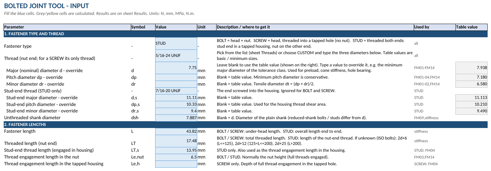{width=100%}

* *Fastener type* and *Thread* are drop-down lists. The thread list comes from sheet Threads.
* The diameter rows are **override** cells. Leave them blank to use the value from the thread table, which is shown in the *Table value* column on the right. Type a value to replace it. A typical reason is to enter the minimum diameters of a tolerance class, or the diameters of a special thread.
* For a STUD, a second thread (the stud end) is selected in the same way.

**Section 3: joint stack.** Enter the clamped layers from the top bearing face downwards:

* the top face is under the head for a BOLT or SCREW, and under the nut for a STUD;
* each row is one washer or plate, with its thickness and Young's modulus;
* leave unused rows blank;
* for a SCREW or STUD the last layer is the housing, measured from the interface down to the end of the engaged thread.

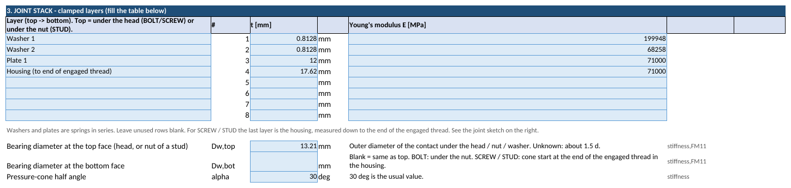{width=100%}

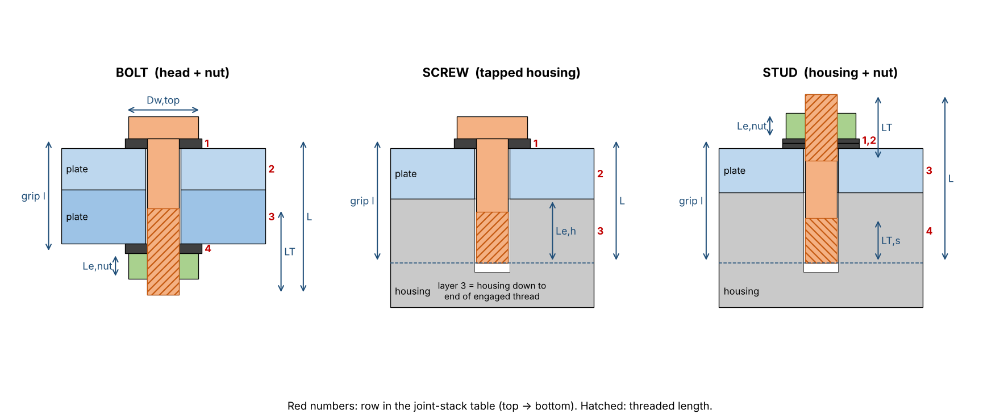{width=100%}

**Sections 4–6: materials, loads and factors, tightening.**

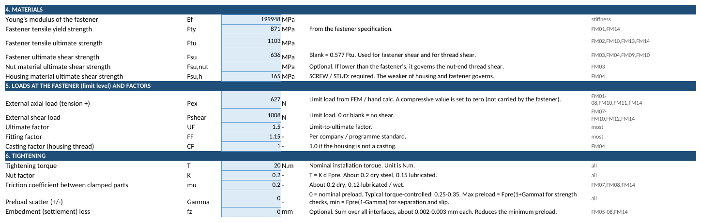{width=100%}

**Section 7: optional checks and input checks.**

* Leave a section-7 input blank if you do not need the corresponding mode. The mode then shows NOT EVALUATED instead of an error.
* The **input checks** below section 7 test the consistency of the inputs, for example: the bearing diameter must be larger than $d$, and $L_T \le L$. They must all read OK before the results are used.

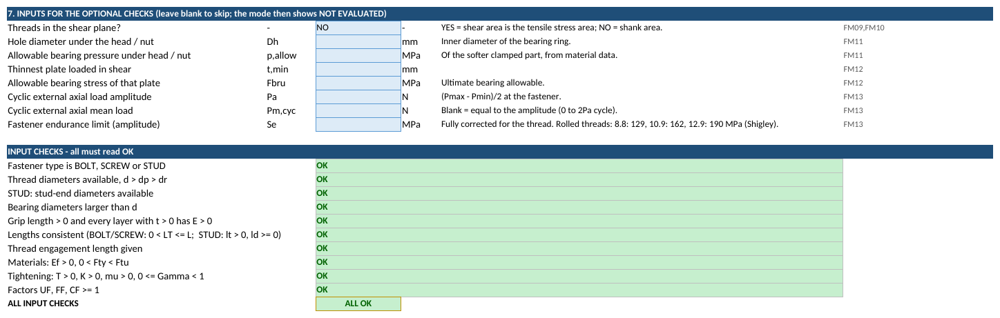{width=100%}

## 2.3 Sheet Results

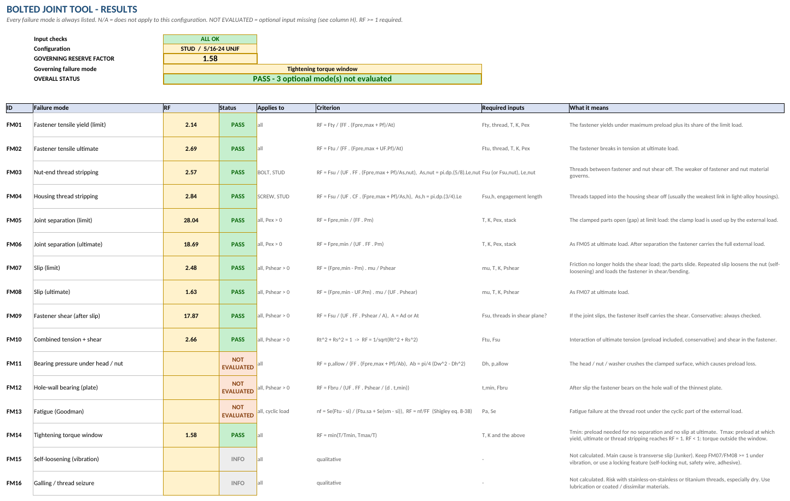{width=100%}

The top block shows four things:

* the input-check status;
* the configuration;
* the **governing RF** and its failure mode;
* the **overall status**.

Below it, **all 16 failure modes are always listed**. Each one has its RF, status, criterion, required inputs and a one-line explanation. The status column means:

| Status | Meaning | What to do |
|---|---|---|
| PASS | RF ≥ 1 | — |
| FAIL | RF < 1 | see chapter 5 |
| N/A | The mode does not exist for this configuration (e.g. nut thread of a SCREW, slip without shear load) | nothing |
| NOT EVALUATED | The mode is real but an optional input is blank | fill the inputs in column *Required inputs* if the mode matters for your task |
| INFO | Qualitative mode, guidance only | read the guidance |

So even on a short task where you only look at a few modes, you can see which modes exist and which ones you skipped.

At the bottom are the torque window and the key intermediate values:

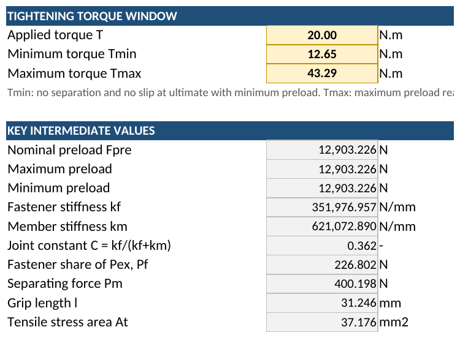{width=55%}

## 2.4 Sheet Calc

Sheet Calc shows every intermediate quantity:

* its symbol, value and unit;
* the equation in readable form;
* a note.

Every value is a live formula that uses named cells. For example, the nominal preload is `=T_tq*1000/(K_nut*d_u)`. To follow any value back to its inputs, use *Formulas → Trace Precedents* or the *Name Manager*.

The member-stiffness section contains the **layer table**: one row per layer, showing how it is split at mid-grip, the cone diameters and the compliance. Chapter 4.4 explains this table.

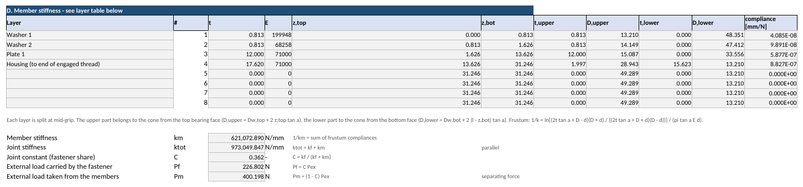{width=100%}

At the end of Calc, the **reserve factor block** evaluates every mode. It also shows two flags per mode: *Applies?* (configuration) and *Input missing?* (optional inputs). Sheet Results takes its status from these two flags.

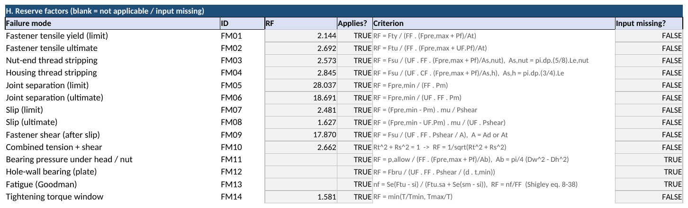{width=100%}

# 3 Worked example

The default inputs of the workbook are the worked example of the in-house method document:

* a 5/16-24 UNJF / 7/16-20 UNJF stud;
* two washers and a 12 mm aluminium plate, in a 71 GPa housing;
* $P_{ex} = 627$ N and $P_{shear} = 1008$ N;
* $T = 20$ N·m and $K = 0.2$.

The table follows the calculation in the same order as sheet Calc.

| Step | Quantity | Value |
|---|---|---|
| Sections | $A_t$ nut end / stud end, $A_d$ | 37.18 / 76.43 / 48.86 mm² |
| Grip | $l = 0.8128 + 0.8128 + 12 + 17.62$ | 31.25 mm |
| Fastener lengths | $l_t = L_T - (L - l)$, $l_d = L - L_T - L_{T,s}$ | 4.91 mm, 12.39 mm |
| Fastener stiffness | $k_f$ | 351 977 N/mm |
| Member stiffness | $k_m$ (layer table) | 621 073 N/mm |
| Load sharing | $C = k_f/(k_f+k_m)$ | 0.362 |
| | $P_f = C P_{ex}$, $P_m = (1-C)P_{ex}$ | 226.8 N, 400.2 N |
| Preload | $F_{pre} = T/(K d) = 20\,000/(0.2 \cdot 7.75)$ | 12 903 N |
| Fastener load | $P_{tot} = F_{pre} + P_f$ | 13 130 N |
| Stress | $\sigma_{lim} = P_{tot}/A_t$ | 353.2 MPa |
| FM01 | $871/(1.15 \cdot 353.2)$ | **2.14** |
| FM03 | $A_{s,nut} = \pi \cdot 7.18 \cdot \tfrac{5}{8} \cdot 6.5 = 91.6$ mm²; $636/(1.5 \cdot 1.15 \cdot 13\,130/91.6)$ | **2.57** |
| FM08 | $(12\,903 - 1.5 \cdot 400.2) \cdot 0.2 / (1.5 \cdot 1008)$ | **1.63** |
| Torque window | $T_{min}$ / $T_{max}$ | 12.6 / 43.3 N·m |
| FM14 | $\min(20/12.6,\ 43.3/20)$ | **1.58** (governing) |

The governing mode is the torque window, because the applied torque is only 1.58 times the minimum required torque. Modes FM11–FM13 show NOT EVALUATED, because their optional inputs are blank in this example.

# 4 Theory

## 4.1 The joint as two springs

A pre-loaded joint behaves like two springs in parallel:

* the **fastener**, stretched by the preload, with stiffness $k_f$;
* the **clamped members**, compressed by the same preload, with stiffness $k_m$.

When an external tensile load $P_{ex}$ is applied, both springs see the **same additional deformation** $\Delta\delta$, as long as the joint stays closed. The fastener stretches further and its force rises. The members unload and the clamp force falls.

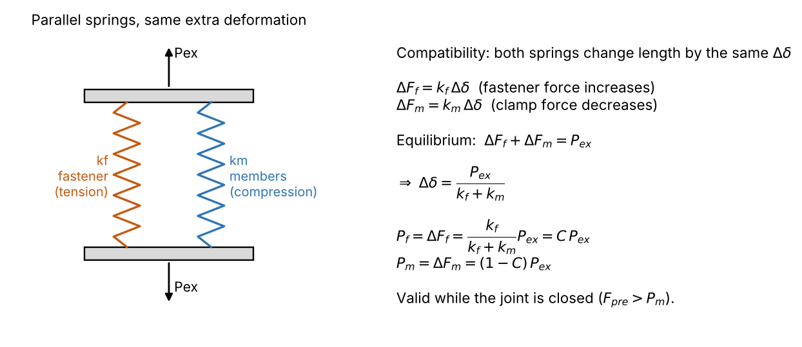{width=100%}

From compatibility ($\Delta F_f = k_f \Delta\delta$, $\Delta F_m = k_m \Delta\delta$) and equilibrium ($\Delta F_f + \Delta F_m = P_{ex}$):

$$C = \frac{k_f}{k_f + k_m}, \qquad P_f = C\,P_{ex}, \qquad P_m = (1 - C)\,P_{ex}$$

* $C$ is the **joint constant**.
* $P_f$ is the additional fastener load.
* $P_m$ is the loss of clamp force. It is called the separating force, because the joint opens when $P_m$ reaches the preload.

A stiff joint ($k_m \gg k_f$) gives a small $C$: the fastener sees only a small part of the external load. That is the main benefit of preload.

{width=62%}

A compressive external load is set to zero ($P_{ex} = \max(P_{ex}, 0)$). It increases the clamp force but does not load the fastener.

## 4.2 Thread geometry and the tensile stress area

A thread is defined by its major diameter $d$, pitch diameter $d_p$, minor diameter $d_r$ and pitch $P$. Tensile tests on threaded rods show that the threaded part fails as if it were a plain bar with a diameter between the pitch and minor diameters. The **tensile stress area** therefore uses their mean:

$$d_t = \frac{d_p + d_r}{2}, \qquad A_t = \frac{\pi d_t^2}{4}$$

* **ISO metric threads.** With $d_p = d - 0.649519P$ and $d_r = d_3 = d - 1.226869P$, this is exactly the stress area $A_s$ of ISO 898-1. For M12×1.75: $A_t = 84.3$ mm².
* **UNC / UNF threads.** The thread table stores the minor diameter $d - 1.299038P$. With that value the same formula reproduces the ASME B1.1 area $\tfrac{\pi}{4}(d - 0.9743P)^2$.
* **UNJF threads.** The table holds the Class 3A minimum pitch and minor diameters.

For a STUD the smaller area of the two ends is used in the strength checks. The plain shank area is $A_d = \pi d_{sh}^2/4$.

## 4.3 Fastener stiffness

Each portion of the fastener inside the grip is a bar with stiffness $AE/\ell$. The portions are loaded in series, so their compliances add.

**BOLT and SCREW.** The plain shank length in the grip is $l_d = \min(L - L_T,\ l)$. The rest of the grip is threaded: $l_t = l - l_d$. Then

$$\frac{1}{k_f} = \frac{l_t}{A_t E_f} + \frac{l_d}{A_d E_f}$$

**STUD.** The stud has three portions in the grip:

* the nut-end thread, length $l_t = L_T - (L - l)$;
* the stud-end thread in the housing, length $L_{T,s}$;
* the plain shank, length $l_d = L - L_T - L_{T,s}$.

$$\frac{1}{k_f} = \frac{l_t}{A_t E_f} + \frac{L_{T,s}}{A_{t,s} E_f} + \frac{l_d}{A_d E_f}$$

The STUD formula is the one in the method document. It reproduces the document's Table 5 ($k_f = 351\,941$ N/mm) within 1 %; the small difference comes from rounded areas in the document.

## 4.4 Member stiffness: pressure cones

**The cone model.** Under the head or nut, the clamp force does not spread over the whole plate. It is carried by a cone of material that widens with depth at the half angle $\alpha$ (30° is the standard value used by Shigley and the method document).

**Stiffness of one frustum.** Consider a frustum of thickness $t$, smallest diameter $D$ and hole diameter $d$. At depth $x$ the outer radius is $r(x) = D/2 + x\tan\alpha$, and the loaded ring has the area

$$A(x) = \pi\left[\left(\frac{D}{2} + x\tan\alpha\right)^2 - \left(\frac{d}{2}\right)^2\right]$$

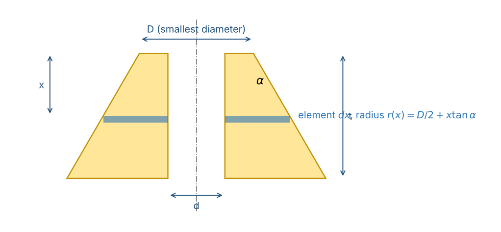{width=72%}

The compression of a thin slice $dx$ is $d\delta = P\,dx/(E\,A(x))$. Integrating over the thickness:

$$\delta = \frac{P}{E}\int_0^t \frac{dx}{\pi\left[(x\tan\alpha + D/2)^2 - (d/2)^2\right]} = \frac{P}{\pi E d \tan\alpha}\ln\!\left[\frac{(2t\tan\alpha + D - d)(D + d)}{(2t\tan\alpha + D + d)(D - d)}\right]$$

This gives the frustum compliance used in the tool (Shigley eq. 8-20):

$$\frac{1}{k} = \frac{\delta}{P} = \frac{1}{\pi E d \tan\alpha}\ln\!\left[\frac{(2t\tan\alpha + D - d)(D + d)}{(2t\tan\alpha + D + d)(D - d)}\right]$$

**Several layers: similar triangles.** One cone starts at the top bearing face (diameter $D_{w,top}$) and one at the bottom face ($D_{w,bot}$). The two cones meet at **mid-grip**, $l/2$. Going down the stack, each layer's frustum starts where the previous one ended, so its smallest diameter follows from similar triangles. The method document writes this with the apex height $h_u = D_{w1}/(2\tan\alpha)$, for example $D_{w2} = D_{w1}(h_u + t_{w1})/h_u$. That is the same as:

$$D_u = D_{w,top} + 2 z_{top} \tan\alpha$$

Here $z_{top}$ is the depth of the layer's top face below the top bearing face.

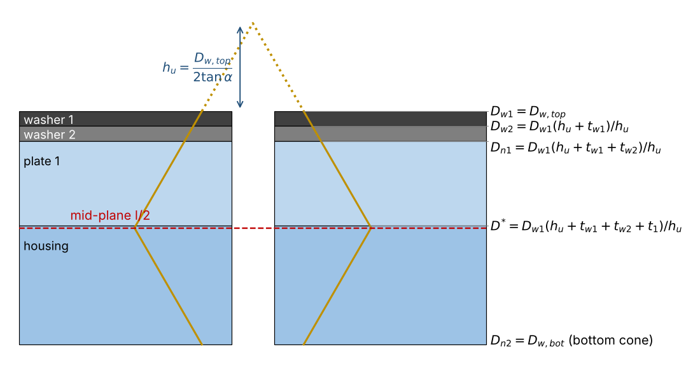{width=100%}

**Splitting at mid-grip.** The layer that contains the mid-plane is split into two parts:

* the part above the mid-plane, of thickness $t_u$, belongs to the top cone;
* the part below, of thickness $t_l$, belongs to the bottom cone.

For the bottom cone, the smallest diameter is at the layer's bottom face:

$$D_l = D_{w,bot} + 2\,(l - z_{bot}) \tan\alpha$$

The tool applies this split rule to **every** layer, so it works for any number of layers, in any order:

* layers wholly above the mid-plane have $t_l = 0$;
* layers wholly below it have $t_u = 0$;
* a zero thickness has zero compliance.

All frusta are in series:

$$\frac{1}{k_m} = \sum_i \left(\frac{1}{k_{u,i}} + \frac{1}{k_{l,i}}\right)$$

{width=72%}

**Check against the method document.** For the document's example, the split gives $t_{middle} = 2.00$ mm and $t_{2,new} = 15.62$ mm, with $D^* = 28.94$ mm, exactly as in its Table 3. The resulting $k_m = 621\,073$ N/mm is within 0.03 % of Table 5 ($620\,902$ N/mm). The document's formula $t_{middle} = l/2 - (t_{w1} + t_{w2}) - t_1$ is the special case for two plates. The old workbooks used it directly, so they failed when the top plate was thicker than $l/2$ (negative $t_{middle}$). The general split has no such limit.

## 4.5 Preload from torque

The installation torque overcomes three things: the thread pitch, the thread friction, and the under-head (or under-nut) friction. VDI 2230 writes this as

$$T = F\left(0.16\,P + 0.58\,\mu_G\, d_p + \mu_K \frac{D_{km}}{2}\right)$$

The **nut-factor** form lumps the three terms into one empirical factor $K$:

$$T = K\, d\, F_{pre} \quad\Rightarrow\quad F_{pre} = \frac{T}{K d} \quad (T\text{ in N·mm})$$

Typical values are $K \approx 0.2$ for dry steel and 0.15 for lubricated threads. When $\mu_G$ and $\mu_K$ are known, $K$ follows from the bracket above divided by $d$.

**Preload scatter and embedment.** The actual preload scatters around the nominal value because friction varies.

$$F_{pre,max} = F_{pre}(1 + \Gamma), \qquad F_{pre,min} = F_{pre}(1 - \Gamma) - F_z, \qquad F_z = f_z\,\frac{k_f k_m}{k_f + k_m}$$

* $F_{pre,max}$ is used where a high preload is critical: yield, thread stripping, bearing.
* $F_{pre,min}$ is used where a low preload is critical: separation, slip.
* $F_z$ is the loss from **embedment**: flattening of surface roughness at every interface after tightening, by a total of $f_z$. Fastener and members relax in series, so the loss is $f_z$ times their series stiffness.
* Typical $\Gamma$: 0.25–0.35 for a torque wrench, about 0.1 for yield- or angle-controlled tightening.
* Typical $f_z$: about 2–3 µm per interface.

With $\Gamma = 0$ and $f_z = 0$ (the defaults) the tool reproduces the method document exactly.

## 4.6 Ultimate load and the factors

Three factors appear in the checks:

| Factor | Default | Meaning |
|---|---|---|
| $UF$ | 1.5 | Limit-to-ultimate factor on external loads. Preload is an internal, installation load and is not multiplied, except in the thread-stripping check (see FM03/FM04). |
| $FF$ | 1.15 | Fitting factor. It covers the uncertainty of loads in joints and fittings. |
| $CF$ | 1.0 | Casting factor. It is applied to the housing thread instead of $FF$, as in the method document. |

The fastener loads at limit and at ultimate are

$$P_{tot} = F_{pre,max} + P_f, \qquad P_{tot,u} = F_{pre,max} + UF\,P_f$$

## 4.7 Failure modes and their equations

**FM01 Tensile yield (limit) and FM02 Tensile ultimate.** The nominal stress in the threaded section is compared with the material strength:

$$RF_{FM01} = \frac{F_{ty}}{FF\cdot P_{tot}/A_t}, \qquad RF_{FM02} = \frac{F_{tu}}{FF\cdot P_{tot,u}/A_t}$$

**FM03 Nut-end thread stripping and FM04 Housing thread stripping.**

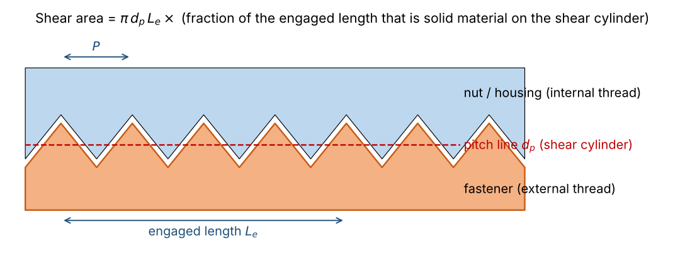{width=95%}

When threads strip, the teeth of one part shear off along a cylinder over the engaged length $L_e$. Only a fraction of that cylinder is solid material of the part that fails; the rest is the mating part's teeth. The method document takes the cylinder at the pitch diameter, with fixed fractions of $\pi d_p L_e$:

$$A_{s,nut} = \pi d_p \tfrac{5}{8} L_{e,nut}, \qquad A_{s,h} = \pi d_p \tfrac{3}{4} L_{e,h}$$

The thread shear stress is $f_s = P_{tot}/A_s$, and the reserve factors are

$$RF_{FM03} = \frac{F_{su}}{UF\cdot FF\cdot f_s}, \qquad RF_{FM04} = \frac{F_{su}}{UF\cdot CF\cdot f_s}$$

Two points are specific to this method:

* **The factor 1.5 multiplies the total load, preload included.** This is the method document's equation, and it is more conservative than factoring only the external part. The previous workbooks factored only $P_f$, which overestimated the RF by up to about 1.5×.
* **$F_{su}$ is the weaker of the two mating materials.** For FM03 that is fastener vs. nut ($F_{su,nut}$); for FM04 it is fastener vs. housing ($F_{su,h}$). Light-alloy housings usually govern FM04.

For comparison, FED-STD-H28/2 (Machinery's Handbook) gives shear areas derived from the thread geometry:

$$A_{S,ext} = \pi L_e D_1\left[0.5 + 0.57735\,\frac{d_p - D_1}{P}\right], \qquad A_{S,int} = \pi L_e\, d\left[0.5 + 0.57735\,\frac{d - D_{p}}{P}\right]$$

For a basic M12×1.75 thread these give $\pi \cdot 7.58\,L_e$ and $\pi \cdot 10.5\,L_e$ (mm²). The method document's $5/8$ and $3/4$ fractions give $\pi \cdot 6.79\,L_e$ and $\pi \cdot 8.15\,L_e$, about 10–22 % smaller, so the method is conservative. Both approaches assume full-profile engagement: do not count chamfered or incomplete threads in $L_e$.

**FM05/FM06 Joint separation and FM07/FM08 Slip.**

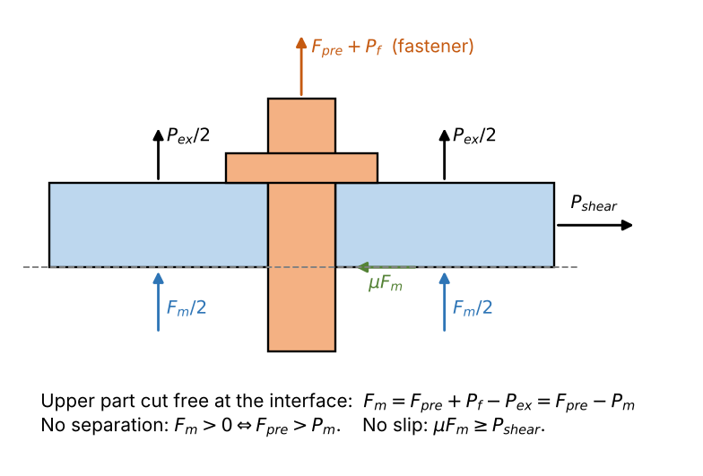{width=88%}

Cut the upper member free at the interface. The clamp force left in the interface is

$$F_m = F_{pre} + P_f - P_{ex} = F_{pre} - P_m$$

**Separation** happens when $F_m = 0$, i.e. when $P_m = F_{pre}$. At limit and at ultimate, with the minimum preload:

$$RF_{FM05} = \frac{F_{pre,min}}{FF\cdot P_m}, \qquad RF_{FM06} = \frac{F_{pre,min}}{UF\cdot FF\cdot P_m}$$

FM06 is the method document's $S_n = F_{pre}/(1.5\,P_{members})\cdot 1/1.15$.

**Slip** happens when the shear load exceeds the friction force $\mu F_m$ at the interface:

$$RF_{FM07} = \frac{(F_{pre,min} - P_m)\,\mu}{P_{shear}}, \qquad RF_{FM08} = \frac{(F_{pre,min} - UF\,P_m)\,\mu}{UF\,P_{shear}}$$

If the joint has already separated, the friction is taken as zero. Slip matters for two reasons. Repeated transverse slip is the main cause of self-loosening. And once the joint slips, the fastener carries the shear directly (FM09–FM12).

**FM09 Fastener shear.** After slip the fastener is loaded in single shear. The shear area $A$ is the shank area $A_d$, or $A_t$ when threads lie in the shear plane:

$$\tau = \frac{UF\cdot FF\cdot P_{shear}}{A}, \qquad RF_{FM09} = \frac{F_{su}}{\tau}$$

The tool always checks this mode when there is a shear load, which is conservative.

**FM10 Combined tension and shear.** With $R_t = FF\,P_{tot,u}/(A_t F_{tu})$ and $R_s = \tau/F_{su}$, the elliptic interaction $R_t^2 + R_s^2 = 1$ is used, as in NASA-STD-5020 and the AISC/Kulak approach. The RF is the factor by which the load point can be scaled up before it reaches the curve:

$$RF_{FM10} = \frac{1}{\sqrt{R_t^2 + R_s^2}}$$

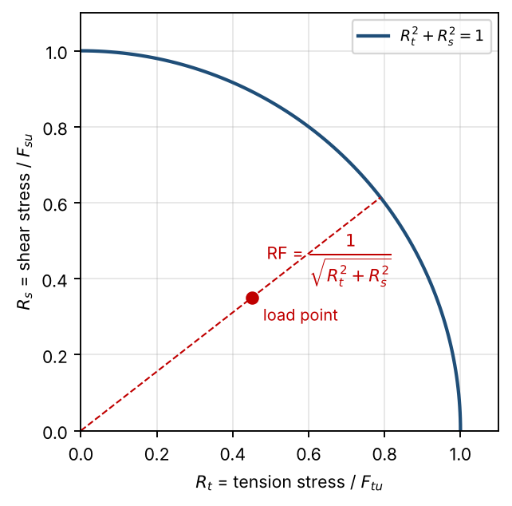{width=48%}

Including preload in $R_t$ is conservative.

**FM11 Bearing pressure under the head or nut.** The bearing ring has the area $A_b = \tfrac{\pi}{4}(D_w^2 - D_h^2)$. For a BOLT the smaller of the two faces is used.

$$RF_{FM11} = \frac{p_{allow}}{FF\cdot P_{tot}/A_b}$$

If the pressure is too high, the clamped surface creeps or crushes, and that costs preload.

**FM12 Hole-wall bearing.** After slip, the fastener bears on the hole wall of the thinnest plate:

$$RF_{FM12} = \frac{F_{bru}}{UF\cdot FF\cdot P_{shear}/(d\,t_{min})}$$

**FM13 Fatigue (Goodman).** The cyclic external load produces an alternating stress $\sigma_a = C P_a/A_t$ around a mean stress $\sigma_m = \sigma_i + C P_{m,cyc}/A_t$, where $\sigma_i = F_{pre,max}/A_t$ is the preload stress. Because of the preload the mean stress is high, so the Goodman line must be used. A check of the amplitude alone is unconservative.

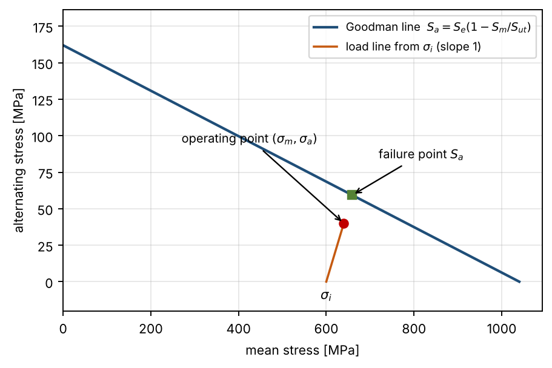{width=65%}

The load line starts at $\sigma_i$ and intersects the Goodman line $S_a = S_e(1 - S_m/F_{tu})$. That gives the safety factor of Shigley eq. 8-38:

$$n_f = \frac{S_e\,(F_{tu} - \sigma_i)}{F_{tu}\,\sigma_a + S_e\,(\sigma_m - \sigma_i)}, \qquad RF_{FM13} = \frac{n_f}{FF}$$

$S_e$ is the endurance limit **of the threaded fastener**. Thread concentration and size effects must already be included. Shigley gives for rolled threads: grade 8.8 = 129 MPa, 10.9 = 162 MPa, 12.9 = 190 MPa.

**FM15 Self-loosening and FM16 Galling** are qualitative.

* **Self-loosening.** Junker showed that transverse slip in the threads and under the head is what turns the nut loose. Keep FM07 and FM08 ≥ 1 under vibration, or add a locking feature.
* **Galling.** Stainless steel and titanium threads can cold-weld during tightening. Lubricate them, or use coated or dissimilar materials.

## 4.8 Tightening-torque window (FM14)

Some modes improve when the torque goes up (separation, slip); others get worse (yield, thread stripping). So there is a window of acceptable torque.

**Minimum torque.** The minimum preload must prevent separation and slip at ultimate load (method document, §2.2.1):

$$F_{req} = UF\,P_m + \frac{UF\,P_{shear}}{\mu}, \qquad T_{min} = \frac{K d\,(F_{req} + F_z)}{1 - \Gamma}$$

**Maximum torque.** The maximum preload must keep FM01–FM04 at RF ≥ 1. Solving each of their equations for $F_{pre,max}$ at RF = 1 gives

$$F_{cap} = \min\left(\frac{F_{ty}A_t}{FF} - P_f,\ \ \frac{F_{tu}A_t}{FF} - UF\,P_f,\ \ \frac{F_{su}A_{s,nut}}{UF\,FF} - P_f,\ \ \frac{F_{su}A_{s,h}}{UF\,CF} - P_f\right), \qquad T_{max} = \frac{K d\, F_{cap}}{1 + \Gamma}$$

**FM14:** $RF = \min(T/T_{min},\ T_{max}/T)$.

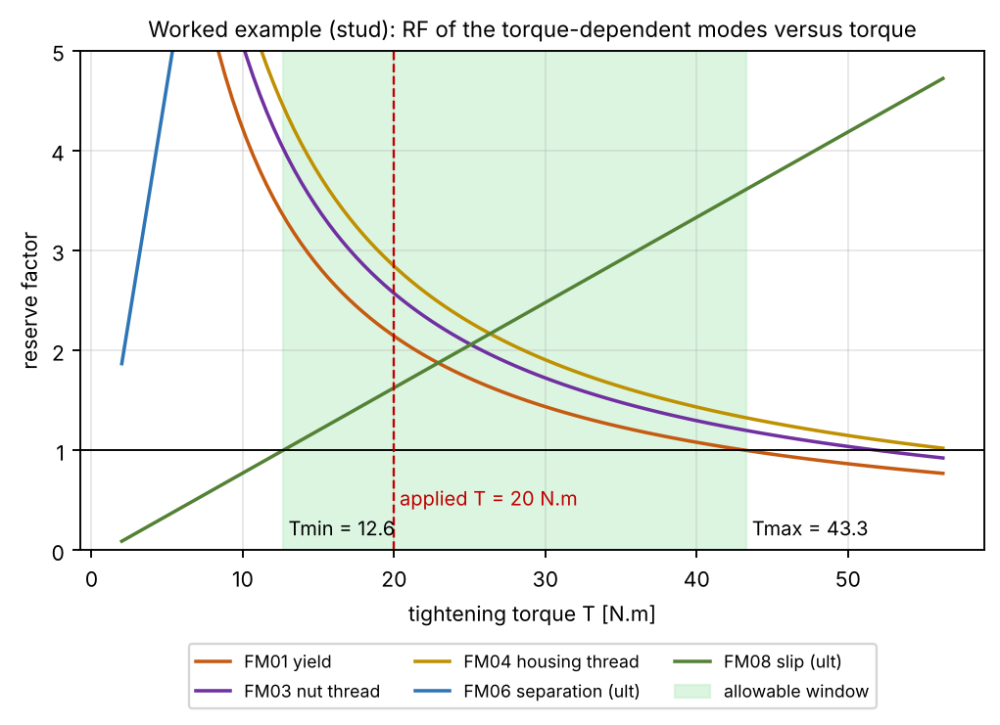{width=85%}

The method document takes the *larger* of the thread-shear and material limits for the maximum preload. The tool takes the *smaller*, because both limits must be respected. In the plot, FM01 reaches RF = 1 exactly at $T_{max}$.

# 5 When a mode fails – design actions

| Failing mode | Typical remedies |
|---|---|
| FM01/FM02 tensile | Larger diameter or higher strength grade; lower torque if FM14 allows; reduce $C$ (stiffer members, longer/thinner-shank fastener) |
| FM03/FM04 stripping | Longer engagement ($L_e \ge 1.5d$ in aluminium); thread insert (helical coil) in soft housings; higher-strength nut; lower torque |
| FM05/FM06 separation | Higher preload (torque); stiffer members (smaller $C$ means smaller $P_m$ per load); more fasteners |
| FM07/FM08 slip | Higher preload; higher friction surface; shear pins or dowels; more fasteners |
| FM09/FM10/FM12 shear, bearing | Larger diameter; shank (not thread) in the shear plane; thicker plate; prevent slip |
| FM11 head bearing | Hardened washer with larger outer diameter; flange head |
| FM13 fatigue | Keep the joint closed (enough preload); reduce $C$ (stiffer members, reduced-shank or longer fastener); threads rolled after heat treatment; larger diameter |
| FM14 window | If $T < T_{min}$: raise torque. If $T > T_{max}$: lower torque. If $T_{min} > T_{max}$: change the design, because no torque works |

# 6 Verification

The workbook is verified in two independent steps.

**1. Workbook vs. Python implementation.** `handcalc/bolted_joint.py` implements the same method independently in Python. The test suite (`tests/`) does the following for five cases (stud, bolt, screw, thick top plate with all options, compressive load):

* writes each case into the workbook;
* lets LibreOffice recalculate it;
* compares every RF, every status and the key intermediate values with the Python results, to a relative tolerance of $10^{-9}$.

**2. Python implementation vs. published values:**

| Check | Reference | Result |
|---|---|---|
| Member stiffness, method-document example | Table 5: 620 902 N/mm | 621 073 N/mm (+0.03 %) |
| $t_{middle}$, $t_{2,new}$, $D^*$, $D_{w2}$, $D_{n1}$ | Table 3: 2.0 / 15.62 / 28.94 / 14.14 / 15.08 mm | identical |
| Fastener stiffness, method-document example | Table 5: 351 941 N/mm | within 1 % |
| Two equal plates | Shigley closed-form $k_m$ | identical ($10^{-12}$) |
| Splitting a plate into two sub-layers | must not change $k_m$ | identical ($10^{-12}$) |
| Bolt sheet of the previous workbook | $k_f$, $k_m$, $F_{pre}$, yield RF | identical ($10^{-8}$) |
| Torque window | RF = 1 at $T = T_{max}$ | exact |

# 7 Assumptions and limits

* **Joint model.** The joint is linear-elastic and loaded concentrically. The cone half angle is constant, and the cone is not truncated by the plate edges. For narrow plates (outer width less than the cone diameter) $k_m$ is overestimated.
* **Separation.** After separation the spring model no longer applies: the fastener then carries the full external load. FM05/FM06 must therefore be ≥ 1 before the other results are meaningful.
* **Thread stripping.** The simplified shear areas of the method document assume full-profile engagement (see 4.7).
* **Nut factor.** $K$ lumps all friction into one number; its scatter is covered by $\Gamma$.
* **Tightening stress.** The combined tension and torsion stress during tightening is not checked. If $F_{pre}/A_t > 0.7\,F_{ty}$, check the tightening condition separately (e.g. VDI 2230 R8).
* **VDI 2230.** VDI 2230 is a licensed standard and is not reproduced here. The optional scatter and embedment terms follow its concepts. The other extensions follow open references (Shigley, NASA-STD-5020).

# 8 Editing the workbook

* **Formulas use named cells**, so they read like the equations in this manual. Examples: `=Fty/(FF_fit*sig_lim)` (FM01) and `=1/SUM(lay_c)` ($k_m$). *Formulas → Name Manager* lists every name.
* **Adding a thread:** insert a row on sheet Threads above the CUSTOM row.
* **After any formula change, run the tests** (`python -m pytest` in the repository). They confirm that the Examples still match the independent implementation.
* **Regenerating from scratch:** the workbook layout is generated by `tools/build_bolted_joint.py`. Use it only if you want to regenerate the file. Do not mix the two ways of editing: a regeneration overwrites manual edits.

# 9 References

1. In-house method document "Fastener Strength Calculations", Issue 1: fastener and member stiffness, similar-triangles method, separation, slip, thread shear, torque.
2. R. G. Budynas, J. K. Nisbett, *Shigley's Mechanical Engineering Design*, chapter 8: frustum stiffness (eq. 8-20), joint constant, fatigue (eq. 8-38).
3. NASA-STD-5020, *Requirements for Threaded Fastening Systems in Spaceflight Hardware*: preload uncertainty, separation, tension–shear interaction.
4. FED-STD-H28/2, *Screw-Thread Standards for Federal Services* / *Machinery's Handbook*: thread shear areas.
5. ISO 898-1, ISO 724, ASME B1.1: thread dimensions and tensile stress areas.
6. VDI 2230 Part 1, *Systematic calculation of highly stressed bolted joints*: torque–preload relation, embedment, scatter (concepts only).
7. G. H. Junker, *New criteria for self-loosening of fasteners under vibration*, SAE 690055.
