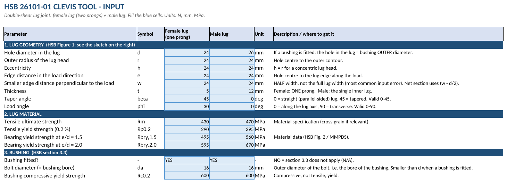
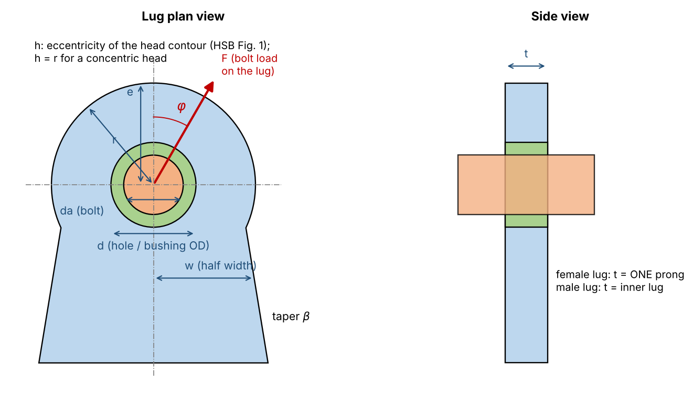
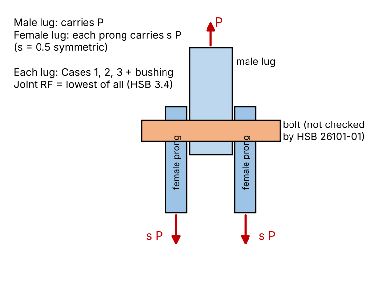
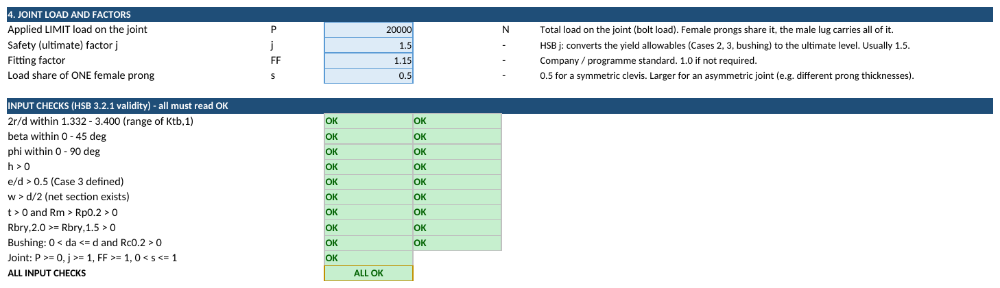
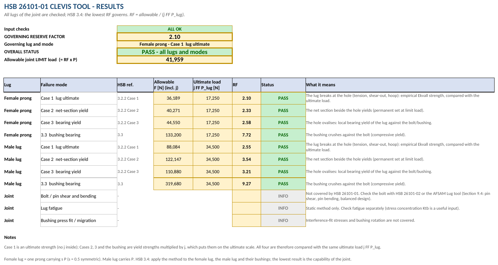
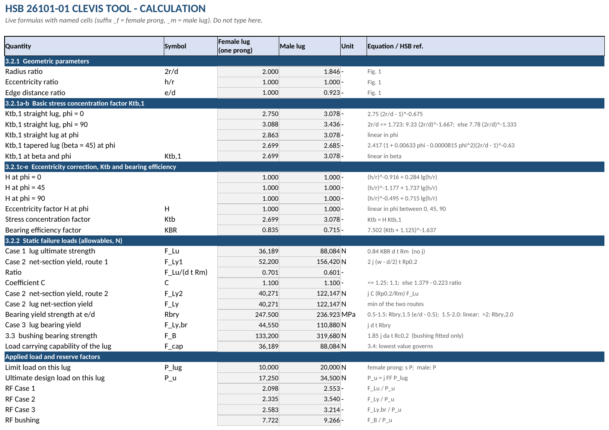
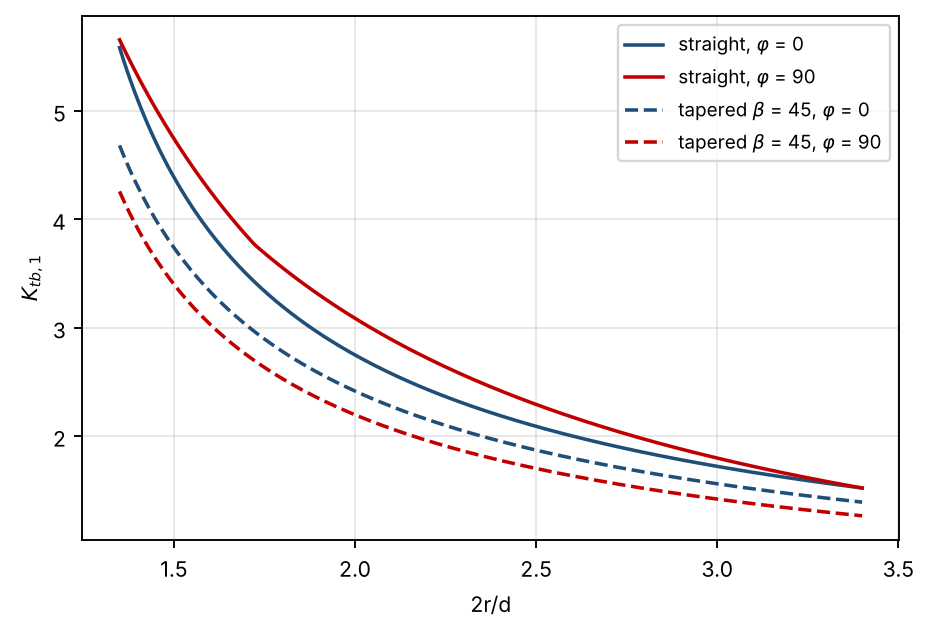
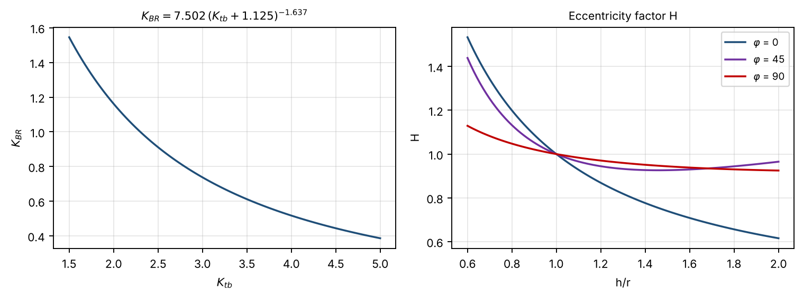
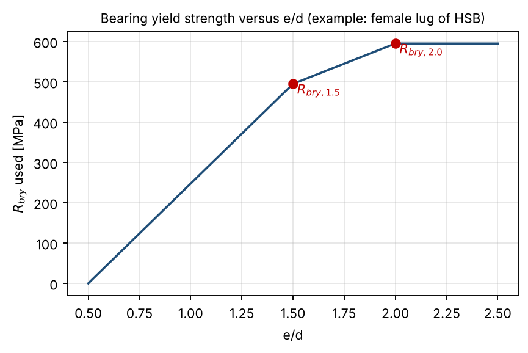

# 1 Introduction

## 1.1 What the tool does

The HSB Clevis Tool (`excel/HSB_Clevis_Tool.xlsx`) checks the static strength of the lugs of a metallic **double-shear joint** (clevis). The joint consists of:

* a **female lug** with two prongs,
* a **male lug** between the prongs,
* one bolt,
* optionally, a bushing in each lug.

The method is that of HSB 26101-01, which is based on Ekvall's analysis of pin-loaded lugs. Each lug is checked for four failure modes:

| Mode | HSB | Physical meaning | Level |
|---|---|---|---|
| Case 1 | 3.2.2 | Lug ultimate strength: the lug breaks at the hole | ultimate |
| Case 2 | 3.2.2 | Net-section yield beside the hole | yield |
| Case 3 | 3.2.2 | Bearing yield: the hole ovalises | yield |
| Bushing | 3.3 | Bushing crushes against the bolt | yield |

HSB section 3.4 requires the female lug, the male lug and their bushings to be checked, with the lowest value governing. The tool does this **in one workbook**:

* the female prong and the male lug are entered side by side;
* the eight checks are evaluated together;
* the governing lug and mode are reported;
* so is the allowable joint limit load.

## 1.2 What the tool does not do

The bolt (pin) is **not** checked. HSB 26101-01 states explicitly that the bolt must be designed separately: use HSB 26101-02 or the AFSAM Lug tool for pin shear and pin bending.

Also not covered:

* fatigue;
* press-fit bushing stresses;
* single-shear joints;
* composite lugs.

The *Results* sheet lists these as INFO rows, so that you always see what is outside the tool.

Units are N, mm and MPa.

# 2 The workbook

## 2.1 Sheets

| Sheet | Purpose | You type here? |
|---|---|---|
| README | Instructions, meaning of j, colour code | no |
| **Input** | Female-prong and male-lug inputs side by side, joint load and factors, input checks, sketches | **yes (blue cells)** |
| **Results** | All 8 lug checks with allowable, applied ultimate load, RF and status; governing mode; allowable joint load; modes not covered | no |
| Calc | Every intermediate value for both lugs with its HSB section | no |
| Examples | The HSB worked example with its published values, and a second regression case | no |

## 2.2 Sheet Input

Each row has two input cells: **Female lug (one prong)** and **Male lug**. The *Description* column says what the symbol is on the drawing. The sketches on the right of the sheet show every symbol.

{width=100%}

{width=95%}

**The most common input error is w.** In HSB notation, $w$ is the *smaller edge distance perpendicular to the load*, i.e. a **half width**, not the full lug width. The net section is $2(w - d/2)\,t$.

For the female lug, $t$ is the thickness of **one prong**. The load on that prong is $s\,P$, where $s = 0.5$ for a symmetric clevis.

{width=85%}

The joint section holds four inputs:

* the limit load $P$;
* the HSB safety factor $j$ (1.5);
* the fitting factor $FF$;
* the prong load share $s$.

Below them are the **input checks**. These are the validity limits of the HSB equations, evaluated for both lugs, and they must all read OK.

{width=100%}

## 2.3 Sheet Results

{width=100%}

For every lug and mode the table shows:

* the **allowable** $F$ from HSB, with $j$ included where HSB includes it;
* the **ultimate design load** on that lug, $j\,FF\,P_{lug}$;
* the **RF** and the status.

The top block gives four things:

* the governing RF;
* the governing lug and mode;
* the overall status;
* the **allowable joint limit load** $RF_{gov} \times P$. This is the largest limit load the joint can take.

Status values: PASS (RF ≥ 1), FAIL (RF < 1), N/A (no bushing fitted), INFO (not covered by the method).

## 2.4 Sheet Calc

Sheet Calc follows the order of HSB section 3.2, with one column per lug. Every cell is a live formula with named cells: `_f` is the female prong and `_m` the male lug. For example, Case 1 for the female prong is `=0.84*KBR_f*d_f*t_f*Rm_f`.

{width=100%}

# 3 Worked example (HSB 26101-01, pages 7–8)

The default input of the workbook is the HSB worked example:

* **female lug:** $d = 24$, $r = h = e = w = 24$, $t = 5$ mm, tapered ($\beta = 45°$), load angle $\varphi = 30°$;
* **male lug:** $d = 26$, $t = 12$ mm, straight, axial load;
* both lugs have bushings with a 16 mm bolt, and $j = 1.5$.

The tool reproduces all 24 published values within 0.2 %:

| Quantity | Female: published | Female: tool | Male: published | Male: tool |
|---|---|---|---|---|
| $K_{tb,1}$ | 2.6987 | 2.6987 | 3.0786 | 3.0783 |
| $K_{BR}$ | 0.8349 | 0.8349 | 0.715 | 0.7151 |
| $F_{Lu}$ [N] | 36 188 | 36 189 | 88 072 | 88 084 |
| $F_{Ly1}$ [N] | 52 200 | 52 200 | 156 420 | 156 420 |
| $F_{Ly2}$ [N] | 40 270 | 40 271 | 122 130 | 122 147 |
| $R_{bry}$ [MPa] | 247.5 | 247.5 | 236.9 | 236.92 |
| $F_{Ly,br}$ [N] | 44 550 | 44 550 | 110 869 | 110 880 |
| $F_B$ [N] | 133 200 | 133 200 | 319 680 | 319 680 |

With a limit load $P = 20\,000$ N, $FF = 1.15$ and $s = 0.5$:

* the female prong carries 10 000 N, i.e. an ultimate load of $1.5 \cdot 1.15 \cdot 10\,000 = 17\,250$ N;
* the governing mode is **female prong, Case 1**, with $RF = 36\,189 / 17\,250 = 2.10$;
* the allowable joint limit load is $2.10 \times 20\,000 = 41\,959$ N.

# 4 Theory

## 4.1 Background

A pin-loaded lug fails by one of three mechanisms, or a mix of them: tension across the net section, shear-out ahead of the hole, or hoop tension at the top of the head. The stress at the hole is highly concentrated, and it depends on the geometry and on the load direction.

Ekvall (1986) correlated the ultimate strength of lugs with a single parameter: the **bearing stress concentration factor** $K_{tb}$. $K_{tb}$ is the peak elastic stress at the hole divided by the nominal bearing stress $F/(d\,t)$. HSB 26101-01 fits $K_{tb}$ with closed-form expressions in the geometric ratios. It derives the ultimate strength from Ekvall's tests and from tests on high-strength aluminium lugs (Rodriguez and Unrasch, 1995). Everything is closed form, so no chart reading is needed.

## 4.2 Geometric ratios

Three ratios drive the method:

$$\frac{2r}{d}\ \text{(head size)}, \qquad \frac{h}{r}\ \text{(eccentricity of the head)}, \qquad \frac{e}{d}\ \text{(edge distance)}$$

## 4.3 Basic stress concentration factor $K_{tb,1}$ (HSB 3.2.1a, b)

For a straight lug under axial load ($\beta = 0$, $\varphi = 0$) and under transverse load ($\varphi = 90°$):

$$K_{tb,1}^{0} = 2.75\left(\frac{2r}{d} - 1\right)^{-0.675}, \qquad K_{tb,1}^{90} = \begin{cases} 9.33\,(2r/d)^{-1.667} & 2r/d \le 1.723 \\ 7.78\,(2r/d)^{-1.333} & 2r/d > 1.723\end{cases}$$

For a straight lug at an intermediate load angle, the tool interpolates linearly in $\varphi$ between these two.

For a tapered lug ($\beta = 45°$) the load angle enters directly:

$$K_{tb,1}^{45} = 2.417\left(1 + 0.00633\,\varphi - 0.0000815\,\varphi^2\right)\left(\frac{2r}{d} - 1\right)^{-0.63}$$

For $0 < \beta < 45°$ the value is interpolated linearly in $\beta$.

{width=70%}

$K_{tb,1}$ falls as the head grows: more material around the hole spreads the bearing load. A tapered lug has lower stress concentration than a straight one, because its sides support the head. The two $\varphi = 90°$ branches meet at $2r/d = 1.723$ (difference < 0.01 %).

## 4.4 Eccentricity and bearing efficiency (HSB 3.2.1c–e)

The eccentricity factor $H$ corrects for a head contour that is not concentric with the hole:

$$H_0 = (h/r)^{-0.916} + 0.284\lg(h/r),\quad H_{45} = (h/r)^{-1.177} + 1.737\lg(h/r),\quad H_{90} = (h/r)^{-0.495} + 0.715\lg(h/r)$$

$H$ is interpolated piecewise-linearly in $\varphi$ between 0°, 45° and 90°. For a concentric lug, $h = r$, so $H = 1$ at every angle.

The factor $H$ then scales $K_{tb,1}$, and the **bearing efficiency factor** $K_{BR}$ converts the resulting stress concentration into a fraction of the ideal bearing strength:

$$K_{tb} = H\,K_{tb,1}, \qquad K_{BR} = 7.502\,(K_{tb} + 1.125)^{-1.637}$$

{width=95%}

## 4.5 Case 1: lug ultimate strength

$$F_{Lu} = 0.84\,K_{BR}\,d\,t\,R_m$$

* $K_{BR}\,d\,t\,R_m$ is Ekvall's ultimate lug load: the bearing area times the tensile strength, reduced by the stress concentration.
* The factor 0.84 is HSB's knockdown on the test data. It turns the mean test strength into a design value.
* Case 1 is an **ultimate** strength, so it contains no $j$.

## 4.6 Case 2: net-section yield

Two estimates are computed and the smaller one is taken.

**Route 1.** The net section $2(w - d/2)\,t$ reaches the yield strength:

$$F_{Ly1} = 2\,j\,(w - d/2)\,t\,R_{p0.2}$$

**Route 2.** The ultimate strength is scaled by the yield-to-ultimate ratio, with an empirical coefficient $C$:

$$F_{Ly2} = j\,C\,\frac{R_{p0.2}}{R_m}\,F_{Lu}, \qquad C = \begin{cases}1.1 & F_{Lu}/(d t R_m) \le 1.25\\ 1.379 - 0.223\,F_{Lu}/(d t R_m) & \text{otherwise}\end{cases}$$

The net-section yield allowable is

$$F_{Ly} = \min(F_{Ly1},\,F_{Ly2})$$

## 4.7 Case 3: bearing yield

The lug material in contact with the bolt yields under compressive bearing. The bearing yield strength $R_{bry}$ is a material property, measured at $e/d = 1.5$ and $e/d = 2.0$. It is higher than the tensile yield, because the bearing material is confined. The tool uses it as follows:

$$R_{bry} = \begin{cases} R_{bry,1.5}\,(e/d - 0.5) & 0.5 < e/d \le 1.5\\ R_{bry,1.5} + 2(e/d - 1.5)(R_{bry,2.0} - R_{bry,1.5}) & 1.5 < e/d \le 2.0\\ R_{bry,2.0} & e/d > 2.0\end{cases}$$

$$F_{Ly,br} = j\,d\,t\,R_{bry}$$

* Below $e/d = 1.5$ the edge material is short, so the bearing strength falls linearly to zero at $e/d = 0.5$: the hole then touches the edge.
* Between 1.5 and 2.0 the value is interpolated.
* Above 2.0 it is constant.

{width=62%}

## 4.8 Bushing (HSB 3.3)

A bushing is loaded by the bolt over the bolt diameter $d_a$ (= bushing bore). It fails by compressive yield (Niu):

$$F_B = 1.85\,j\,d_a\,t\,R_{c0.2}$$

The factor 1.85 reflects the confined state of the bushing in the lug hole. If no bushing is fitted, this mode is N/A. In that case $d$ is both the hole and the bolt diameter, and the lug material itself is checked by Case 3.

## 4.9 The safety factor j and the reserve factor

* Case 1 is an **ultimate** strength.
* Cases 2, 3 and the bushing are **yield** strengths. HSB writes them with $j$ inside. Multiplying a yield allowable by $j$ puts it on the ultimate scale, because yield is checked at limit load and limit load $\times\,j$ = ultimate load.

So all four values can be compared with the same ultimate design load:

$$P_{u} = j\,FF\,P_{lug}, \qquad RF = \frac{F_{case}}{P_u}, \qquad P_{lug} = \begin{cases} s\,P & \text{female prong}\\ P & \text{male lug}\end{cases}$$

For a yield case this is identical to $F_{yield}/(FF\cdot P_{lug})$, i.e. yield at limit load.

**Do not apply $j$ a second time.** Do not add an extra factor to Cases 2 and 3 either. The fitting factor $FF$ applies to all cases equally.

HSB 3.4 then gives the joint result:

$$RF_{joint} = \min_{\text{lugs, cases}} RF, \qquad P_{allow,limit} = RF_{joint}\cdot P$$

# 5 Validity limits (input checks)

| Check | Reason |
|---|---|
| $1.332 \le 2r/d \le 3.400$ | range in which the $K_{tb,1}$ fits are defined |
| $0 \le \beta \le 45°$, $0 \le \varphi \le 90°$ | range of the HSB expressions |
| $h > 0$ | $\lg(h/r)$ |
| $e/d > 0.5$ | Case 3 defined |
| $w > d/2$ | a net section exists |
| $R_m > R_{p0.2} > 0$, $t > 0$ | physical material data |
| $R_{bry,2.0} \ge R_{bry,1.5}$ | bearing strength rises with $e/d$ |
| bushing: $0 < d_a \le d$, $R_{c0.2} > 0$ | the bolt fits in the bushing |

The HSB method is calibrated on test data for steel and high-strength aluminium lugs. Results for other metals are an extrapolation, so cross-check them, e.g. with the AFSAM tool.

# 6 When a lug fails – design actions

| Failing mode | Typical remedies |
|---|---|
| Case 1 ultimate | Larger head ($2r/d$), thicker lug, tapered head, stronger material |
| Case 2 net-section yield | Wider lug (larger $w$), thicker lug, higher yield strength |
| Case 3 bearing yield | Larger edge distance ($e/d \ge 1.5$–2), larger hole/bushing, thicker lug |
| Bushing | Larger bolt diameter, higher-strength bushing, longer bushing |
| Female prong governs | Thicker prongs or asymmetric thickness; check $s$ |

# 7 Verification

* **Published example.** The Python implementation `handcalc/hsb_clevis.py` and the workbook (recalculated by LibreOffice in the test suite) both reproduce all 24 published values of the HSB worked example within 0.2 %.
* **Workbook vs. Python.** For two cases, the workbook and the Python implementation agree to $10^{-9}$ for every intermediate value, every RF and every status. The second case covers an eccentric head ($h \ne r$), $\varphi = 60°/75°$, $\beta = 20°$ and a lug without bushing.
* **Branch continuity.** The tests also check the continuity of the piecewise expressions at $2r/d = 1.723$ and $e/d = 1.5$ and $2.0$.

The published example covers $h/r = 1$ only, and $\varphi$ only at 0° and 30° (with $\beta = 45°$). The eccentricity and $\varphi$-interpolation branches are therefore verified for internal consistency, not against a published number.

# 8 Changes from the previous workbook (v6.0)

* Female and male lugs are evaluated together, with the joint load split between them. The joint result and the allowable joint load are computed automatically.
* Explicit inputs for $P$ (limit), $j$, $FF$ and $s$, so it is clear which load level each value refers to. The previous version had $j = 1$ with notes referring to a factor of 3.
* **Bug fixed:** the Dashboard showed a hard-coded $r = 30$ mm instead of the input value.
* **Bug fixed:** the input check "$d_a \ge d$" was wrong, and failed for HSB's own example ($d_a = 16 < d = 24$). $d_a$ is the bolt diameter (bushing bore).
* The bushing can be switched off (N/A).
* The verification no longer uses a separate copy of the formulas, which could drift from the calculation sheet. The automated tests run the actual calculation against the published values.
* Out-of-scope modes are listed on Results as INFO.

# 9 Editing the workbook

* Formulas use named cells (*Formulas → Name Manager*). Female-prong names end in `_f` and male-lug names in `_m`.
* After changing a formula, run `python -m pytest` in the repository. The HSB published values are part of the tests.
* The layout is generated by `tools/build_hsb_clevis.py`. Use it only to regenerate the file from scratch; a regeneration overwrites manual edits.

# 10 References

1. HSB 26101-01, *Static failure loads of metallic double shear lugs*, Issue E, 2006.
2. J. C. Ekvall, *Static strength analysis of pin-loaded lugs*, Journal of Aircraft, Vol. 23, No. 5, 1986.
3. Rodriguez, Unrasch, *Lugs of high strength aluminium alloys*, FH Hamburg, 1995.
4. M. C. Y. Niu, *Airframe Structural Design*, 1990 (bushing bearing).
